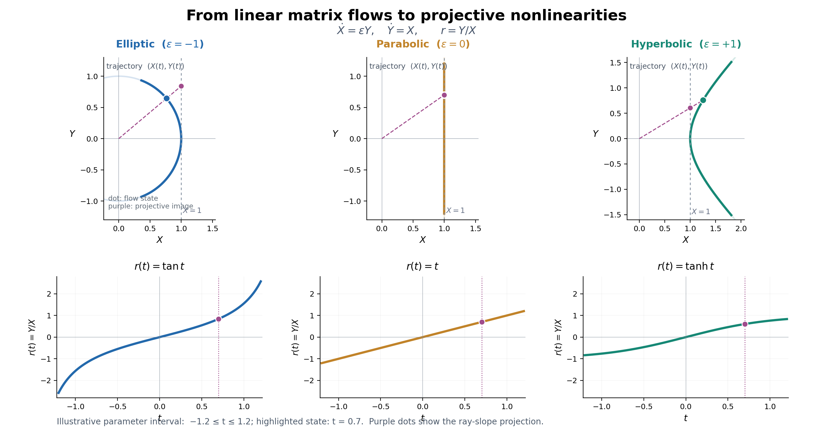

## — From Natural Exponentials and Generator Algebra to Projective Representations and Tensor Actions

> **Scope of this note.** This is a research note supported by mathematical derivations, not a research paper claiming a new theorem. Its central subject is **linear actions generated by the natural exponential, their projective representations, and their tensor structures**. Fourier analysis, Lorentz transformations, and neural units serve as complementary windows onto these structures. The note places established results on matrix exponentials, Lie-group and projective actions, harmonic analysis, and differentiation into a coherent, verifiable line of reasoning. Its intended contribution lies primarily in **organizing questions, developing a cross-disciplinary interpretive perspective, and identifying the boundaries of applicability**, not in claiming originality for the underlying identities.

## Abstract

A simple circular mode can be superposed with others to approximate a complicated curve; a unit defined through hyperbolic functions can likewise contribute to the approximation of nonlinear functions. Rather than treating neural networks as its principal subject, this note uses that comparison to return to the natural exponential and matrix generators, asking which mathematical actions are shared and which properties depend on representation and observation. Centered on two-dimensional generators satisfying \( A_\varepsilon^2=\varepsilon I \), the discussion relates circular rotations, hyperbolic transformations, nilpotent shears, and their projective dynamics. A Lorentz boost provides a brief comparison illustrating how a single hyperbolic generator admits both a quadratic-form-preserving linear action and a nonlinear projective readout; the induced action on higher-order tensors is mentioned only as a direction for subsequent study. Fourier analysis, the `tanh` function, and neural learning are used as concrete cross-disciplinary examples of linear contraction, nonlinear readout, higher-order derivatives, and gradient actions.

The central observation is that **a function's nonlinear appearance need not imply an equally complicated underlying generating action: the projective representation obtained by taking component ratios of a linear matrix flow can exhibit explicit nonlinear dynamics.** This does not imply that *all* nonlinearity is merely an artifact of representation, nor does the presence of hyperbolic functions establish Lorentz symmetry in a neural network. Throughout, mathematical identities, established theory, and open questions for further investigation are kept distinct.

---

## 1. Starting Point: From Circular Modes That Draw Curves to Learnable Function Units

The initial intuitive question was: why can combinations of simple uniform circular motions draw intricate curves? Writing a planar curve as a complex-valued function,

$$
z(t)=x(t)+iy(t),
$$

we may approximate a suitably parametrized closed curve by Fourier partial sums:

$$
z(t)\approx\sum_{n=-N}^{N}c_n e^{int}.
\tag{1.1}
$$

Each \( e^{int} \) is merely a rotation mode with a fixed angular velocity. The complexity resides in the coefficients and in how the modes combine. For periodic \( L^2 \) functions, the partial sums converge in the mean-square sense; pointwise or uniform convergence requires corresponding additional regularity assumptions.

On the other hand, a single-hidden-layer network using `tanh` can be written as

$$
f_N(\mathbf x)
=\sum_{a=1}^{m}v_a\tanh(\mathbf w_a\cdot\mathbf x+b_a)+c.
\tag{1.2}
$$

These two expressions immediately raise three distinct questions:

1. **Representation:** Can different elementary functions be expressed within a common framework of simple contractions and superpositions?
2. **Generation:** Do sine, cosine, and `tanh` have comparable origins in matrix exponentials?
3. **Learning:** When a neural network changes its weights, can the evolution of its functional shape be described in tensorial and spectral terms?

This note treats these questions in sequence, without collapsing them into a single claim of equivalence.

## 2. Fourier Analysis: A Modal Representation of Translation Actions

We adopt the following convention for the \( d \)-dimensional Fourier transform:

$$
\widehat f(\mathbf k)
=\int_{\mathbb R^d}f(\mathbf x)e^{-ik_i x^i}\,d^d x,
\qquad
f(\mathbf x)
=\frac{1}{(2\pi)^d}
\int_{\mathbb R^d}\widehat f(\mathbf k)e^{ik_i x^i}\,d^d k.
\tag{2.1}
$$

Here \( k_i x^i \) is the contraction of a covector with a vector; in standard Euclidean Cartesian coordinates it is also written \( \mathbf k\cdot\mathbf x \). Viewing integration as contraction over continuous indices, the Fourier kernel is

$$
\mathcal K(\mathbf k,\mathbf x)=e^{-ik_i x^i},
\qquad
\widehat f(\mathbf k)
=\int\mathcal K(\mathbf k,\mathbf x)f(\mathbf x)\,d^dx.
\tag{2.2}
$$

The finite-dimensional discrete Fourier transform is

$$
\widehat f_m=F_m{}^n f_n.
\tag{2.3}
$$

It can therefore be understood as a linear map. However, **a matrix with two indices** should not automatically be identified with a rank-two geometric tensor in physical spacetime. Here the indices primarily label the input and output representation spaces.

Fourier modes are special because translation acts as

$$
e^{ik(x+a)}=e^{ika}e^{ikx}.
\tag{2.4}
$$

Thus complex exponentials are eigenfunctions of translation operators. For suitable functions and boundary conditions, differentiation becomes multiplication in the frequency representation:

$$
\mathcal F[\partial_i f]=ik_i\widehat f,
\qquad
\mathcal F[\partial_i\partial_j f]=-k_i k_j\widehat f.
\tag{2.5}
$$

This is one reason Fourier representations are so useful for differential equations. They do not eliminate every source of complexity; rather, they efficiently diagonalize operators in linear problems with translation symmetry.

## 3. Neural Units: Nonlinear Maps Following Linear Contraction

Let the input vector have components \( x^i \). The preactivation and output of neural unit \( a \) are

$$
u^a=W^a{}_i x^i+b^a,
\qquad
h^a=\tanh(u^a).
\tag{3.1}
$$

A linear output layer gives

$$
y=v_a h^a+c.
\tag{3.2}
$$

Under a fixed choice of coordinates and inner-product conventions, \( W^a{}_i \) denotes the components of a linear map from the input space to the hidden-layer space. The `tanh` function acts componentwise and **does not, in general, retain the same componentwise form under arbitrary changes of basis in the hidden layer**. This is an important qualification when discussing general tensor covariance.

A single-hidden-layer `tanh` network has the universal approximation property: with sufficiently many units, it can uniformly approximate continuous functions on suitable compact domains to arbitrary accuracy. However, **the existence of a suitable parameter choice** does not imply that a generic training algorithm will find it, or that the number of required units remains small in every high-dimensional problem. [1–3]

At the level of representation, Fourier synthesis and single-hidden-layer networks both fall within the family

$$
\boxed{
 f(\mathbf x)=\sum_a c_a\,\phi_a(q_{ai}x^i+b_a)
}
\tag{3.3}
$$

but this common form should not obscure the difference between a fixed basis and learnable parameters.

## 4. Returning to the Natural Exponential: Three Two-Dimensional Generators

To make the relationship between trigonometric and hyperbolic functions clearer, consider the following unified family of generators. A distinction is essential at the outset: **the natural exponential function is not itself a tensor**. Transformations acting on different tensor spaces arise when the exponential is applied to a linear operator or one of its induced representations:

$$
A_\varepsilon=
\begin{pmatrix}0&\varepsilon\\1&0\end{pmatrix},
\qquad
A_\varepsilon^2=\varepsilon I,
\qquad
\varepsilon\in\{-1,0,+1\}.
\tag{4.1}
$$

The matrix exponential is defined by its power series:

$$
e^{tA_\varepsilon}
=\sum_{n=0}^{\infty}\frac{t^n A_\varepsilon^n}{n!}.
\tag{4.2}
$$

Separating even and odd powers gives

$$
e^{tA_\varepsilon}
=\begin{pmatrix}
C_\varepsilon(t)&\varepsilon S_\varepsilon(t)\\
S_\varepsilon(t)&C_\varepsilon(t)
\end{pmatrix},
\tag{4.3}
$$

where

| \( \varepsilon \) | \( C_\varepsilon(t) \) | \( S_\varepsilon(t) \) | Generator type | Geometric interpretation |
|---|---|---|---|---|
| \( -1 \) | \( \cos t \) | \( \sin t \) | Elliptic | Circular rotation |
| \( 0 \) | \( 1 \) | \( t \) | Parabolic | Shear / nilpotent flow |
| \( +1 \) | \( \cosh t \) | \( \sinh t \) | Hyperbolic | Hyperbolic transformation |

All three generators \( A_\varepsilon \) have zero trace, so \( \det e^{tA_\varepsilon}=1 \) and their exponentials form one-parameter subgroups of \( SL(2,\mathbb R) \). This is a standard elementary example from Lie-group theory, not a new construction.

Starting from \( (1,0)^T \),

$$
\begin{pmatrix}X(t)\\Y(t)\end{pmatrix}
=e^{tA_\varepsilon}
\begin{pmatrix}1\\0\end{pmatrix}
=\begin{pmatrix}C_\varepsilon(t)\\S_\varepsilon(t)\end{pmatrix}.
\tag{4.4}
$$

The components satisfy

$$
\dot X=\varepsilon Y,
\qquad
\dot Y=X,
\qquad
X^2-\varepsilon Y^2=1.
\tag{4.5}
$$

For \( \varepsilon=-1 \), the last relation is the circular invariant \( X^2+Y^2=1 \); for \( \varepsilon=+1 \), it is the hyperbolic invariant \( X^2-Y^2=1 \); for \( \varepsilon=0 \), it degenerates to \( X^2=1 \), describing the special nilpotent flow. These **invariants** belong to the specified matrix-group actions. They cannot be treated as conservation laws for arbitrary physical systems without further justification.

### 4.1 Two Readouts of a Hyperbolic Generator: Lorentz Boost and `tanh`

A hyperbolic generator admits two closely related readings that should not be conflated into a single physical proposition. Let

$$
K=A_{+1}=\begin{pmatrix}0&1\\1&0\end{pmatrix},
\qquad \eta=\begin{pmatrix}1&0\\0&-1\end{pmatrix},
\qquad
\Lambda(t)=e^{tK}=\begin{pmatrix}\cosh t&\sinh t\\\sinh t&\cosh t\end{pmatrix}.
$$

Because \( K^T\eta+\eta K=0 \),

$$
\boxed{\Lambda(t)^T\eta\Lambda(t)=\eta.}
\tag{4.6}
$$

**As a linear action:** in \( (1+1) \)-dimensional Minkowski geometry, with the sign convention adopted here, this is a one-dimensional Lorentz boost parametrized by rapidity. **As a projective readout:** the same matrix flow acts on \( (1,0)^T \) to yield \( X=\cosh t \) and \( Y=\sinh t \); their ratio is \( h(t)=Y/X=\tanh t \). When the parameter is increased by \( s \),

$$
\boxed{h(t+s)=\frac{h(t)+\tanh s}{1+h(t)\tanh s}}.
\tag{4.7}
$$

This is a Möbius fractional-linear action, and it has the same algebraic form as the one-dimensional relativistic velocity-addition law (with signs and the direction of relative motion depending on convention). For a generic `tanh` neural unit, \( t=w_ix^i+b \) and \( s \) may simply represent an increment in preactivation. **No neural-network input is being interpreted here as a physical rapidity, and no Lorentz equivariance of the network is being claimed.** The corresponding three-branch expression appears later as Eq. (5.4).

To retain the tensorial thread of the note, we record only one induced representation. If \( T^{ij} \) is a rank-two contravariant tensor, then

$$
\begin{aligned}
T'^{ij}&=\Lambda^i{}_p\Lambda^j{}_qT^{pq},\\
\Lambda^{\otimes2}&=e^{t(K\otimes I+I\otimes K)}.
\end{aligned}
\tag{4.8}
$$

The generator sum \( K\otimes I+I\otimes K \) is simply the **Leibniz product rule** written for a tensor product: when \( v \) and \( w \) both evolve according to \( \dot v=Kv \) and \( \dot w=Kw \), differentiating \( v\otimes w \) makes \( K \) act once on each tensor factor.

*Figure 1. Induced tensor generator. The time derivative of \( v\otimes w \) splits into \( (Kv)\otimes w+v\otimes(Kw) \), which gives \( K\otimes I+I\otimes K \). Each tensor slot carries the same underlying generator; the dimension of the base vector space does not change.*

This shows that the same generator can be lifted to a higher-order tensor action, but **increasing tensor order does not increase the dimension of the underlying space**. The general induced representation for arbitrary tensor order and mixed covariant/contravariant indices is reserved for a separate tensor note; relativity is not developed further here.

## 5. Central Derivation: How a Linear Matrix Flow Becomes Nonlinear Projective Dynamics

We now observe only the ratio of the two components:

$$
r(t)=\frac{Y(t)}{X(t)},\qquad X(t)\ne0.
\tag{5.1}
$$

**Geometric intuition.** The number \( r(t) \) is the slope of the **ray through the origin** and the moving point \( (X(t),Y(t)) \). For \( X(t)\ne0 \), the same ray meets the line \( X=1 \) at \( (1,r(t)) \). In other words, the two-dimensional linear trajectory is being read in a projective coordinate; \( r(t) \) is **not** the tangent slope of the trajectory itself.

*Figure 2. Linear trajectories (upper row) and projective readouts (lower row) for the same initial condition \( (X(0),Y(0))=(1,0) \). The blue elliptic branch traces a circle and gives \( r=\tan t \); the amber parabolic branch traces a straight line and gives \( r=t \); the green hyperbolic branch traces a hyperbola and gives \( r=\tanh t \). The dashed ray and purple dot mark the projection onto \( X=1 \) at \( t=0.7 \). The panels show \( -1.2\le t\le1.2 \); the tangent poles at \( X=0 \) lie outside this interval and represent a projective-chart singularity, not a blow-up of the circular flow.*

Applying the quotient rule and Eq. (4.5),

$$
\begin{aligned}
\dot r
&=\frac{X\dot Y-Y\dot X}{X^2}\\
&=\frac{X^2-\varepsilon Y^2}{X^2}\\
&=1-\varepsilon r^2.
\end{aligned}
\tag{5.2}
$$

The three cases therefore emerge naturally:

$$
\boxed{
\begin{array}{c|c|c}
\varepsilon&r(t)&\dot r(t)\\\hline
-1&\tan t&1+r^2\\
0&t&1\\
+1&\tanh t&1-r^2
\end{array}
}
\tag{5.3}
$$

The representation by \( \tan t \) is valid only in a projective coordinate chart where \( \cos t\ne0 \); crossing its poles requires a change of projective chart.

**Organizing proposition (an elementary special case of an established result).** A linear matrix flow \( e^{tA_\varepsilon} \) with \( A_\varepsilon^2=\varepsilon I \) induces, in appropriate component-ratio coordinates, the Riccati-type dynamics \( \dot r=1-\varepsilon r^2 \).

Here **nonlinear** means that the evolution equation in the coordinate \( r \) contains a quadratic term. The underlying dynamics of \( (X,Y) \) remain linear. These statements are compatible because the representation variables have changed. Nor does this imply that every nonlinear system can be reduced to a finite-dimensional linear one.

The parameter-composition laws also share a common form:

$$
\boxed{
 r(t+s)=\frac{r(t)+r(s)}{1+\varepsilon r(t)r(s)}
}
\tag{5.4}
$$

This formula applies wherever the denominator is nonzero and the relevant projective charts are valid. It incorporates the tangent addition law, ordinary addition, and the hyperbolic tangent addition law, respectively.

### 5.1 How a General Linear Generator Produces a Riccati Equation

For an arbitrary constant matrix,

$$
A=\begin{pmatrix}a&b\\c&d\end{pmatrix},
\qquad
\frac{d}{dt}\begin{pmatrix}X\\Y\end{pmatrix}
=A\begin{pmatrix}X\\Y\end{pmatrix},
$$

the ratio \( r=Y/X \) obeys

$$
\boxed{\dot r=c+(d-a)r-br^2.}
\tag{5.5}
$$

Thus the preceding three-way classification is not an accidental resemblance among functions. It is a standard feature of two-dimensional linear flows acting on the projective line. [8]

### 5.2 Sigmoid: Another Projective Readout of the Same Hyperbolic Flow

The logistic function and hyperbolic tangent satisfy the exact identity

$$
\boxed{\sigma(u)=\frac{1}{1+e^{-u}}
=\frac{1+\tanh(u/2)}2.}
\tag{5.6}
$$

This relationship becomes transparent in the eigenbasis of the hyperbolic flow. Let \( p(u)=e^{-u/2} \) and \( q(u)=e^{u/2} \). Then \( (p,q)^T \) is a linear flow generated by the diagonal matrix \( B=\operatorname{diag}(-1/2,1/2) \). Taking a normalized component gives

$$
\boxed{s(u)=\frac{q(u)}{p(u)+q(u)}=\sigma(u),
\qquad \frac{ds}{du}=s(1-s).}
\tag{5.7}
$$

Alternatively, set \( X=(p+q)/2 \) and \( Y=(q-p)/2 \). Then \( r=Y/X=\tanh(u/2) \) and \( s=(1+r)/2 \). These are distinct projective readouts of the same underlying hyperbolic linear action, with a corresponding change of parameter scale: the fixed points of \( r \) are \( \{-1,1\} \), whereas those of \( s \) are \( \{0,1\} \). The affine change of coordinates here is also a special case of a Möbius transformation.

The purpose of this example is to distinguish the roles of **generator, coordinate choice, and nonlinear readout**. The higher-dimensional normalization underlying Softmax has a comparable relationship to simplex geometry, but its multivariable structure merits a separate note and is not developed here.

## 6. For a `tanh` Neural Unit, Projective Representation Leads Directly to the Learning Gradient

Replace the parameter \( t \) with the preactivation of a neural unit:

$$
u=w_i x^i+b.
\tag{6.1}
$$

In the hyperbolic case \( \varepsilon=+1 \),

$$
\begin{pmatrix}X\\Y\end{pmatrix}
=e^{uA_{+1}}\begin{pmatrix}1\\0\end{pmatrix}
=\begin{pmatrix}\cosh u\\\sinh u\end{pmatrix},
\quad
h=\frac{Y}{X}=\tanh u.
\tag{6.2}
$$

By Eq. (5.2),

$$
\boxed{
\frac{dh}{du}
=1-h^2
=\frac{1}{X^2}
=\operatorname{sech}^2u
}
\tag{6.3}
$$

This gives a particularly transparent connection: **the derivative-gating factor \( 1-h^2 \) of a neural unit is exactly the rate of change of a projective coordinate of the hyperbolic matrix flow.** When \( |u| \) is large, \( X=\cosh u \) grows, making \( 1/X^2 \) small. This is the familiar saturation and gradient suppression of `tanh`.

It is an immediately verifiable identity, not a newly discovered law of neural learning.

For one training example, suppose the network, loss, and prediction error are

$$
y=v_a h^a+c,
\qquad
L=\frac12(y-y_\ast)^2,
\qquad
e=y-y_\ast.
\tag{6.4}
$$

The chain rule gives

$$
\frac{\partial L}{\partial W^a{}_i}
=e\,v_a\bigl[1-(h^a)^2\bigr]x^i.
\tag{6.5}
$$

Writing

$$
\delta_a=e\,v_a\bigl[1-(h^a)^2\bigr],
$$

we obtain

$$
\boxed{
\frac{\partial L}{\partial W^a{}_i}=\delta_a x^i.
}
\tag{6.6}
$$

Thus the weight-gradient matrix for one example is a vector outer product, of rank at most one; a minibatch update sums such outer products. This **outer-product tensor** is an algebraic consequence of differentiation. It does not imply that the learning dynamics of a whole multilayer network are linear.

### 6.1 Activation Functions as Observational Windows: Saturation, Gating, and Other Generating Mechanisms

The two-sided saturation of `tanh` means that \( h'=1-h^2\to0 \); Sigmoid has a similarly saturating derivative. This illustrates how the derivative properties of elementary functions affect gradient propagation, although gradients in deep networks also depend on the weights and on products of interlayer Jacobians. A concise modern extension is SiLU (Swish):

$$
\phi_{\mathrm{SiLU}}(u)=u\sigma(u),\qquad
\phi_{\mathrm{SiLU}}'(u)
=\sigma(u)+u\sigma(u)(1-\sigma(u)).
\tag{6.7}
$$

It multiplies an approximately linear channel by a smooth gate; its slope approaches \( 1 \) for large positive inputs. ReLU's piecewise-linear action, GELU's **Gaussian cumulative-distribution** gate, and multichannel multiplicative architectures have different exact mathematical mechanisms. The `tanh` expression commonly used for GELU is only an approximation: one cannot claim that all these functions are generated by the same two-dimensional constant-coefficient hyperbolic generator. We stop here; their classification, multiplicative tensors, and training behavior are reserved for independent notes.

## 7. A Common Higher-Order Derivative Tensor Structure

Consider the general form

$$
f(\mathbf x)=\sum_a c_a\phi_a(u_a),
\qquad u_a=q_{ai}x^i+b_a.
\tag{7.1}
$$

Repeated application of the chain rule, in fixed affine coordinates with constant \( q_{ai} \), yields

$$
\boxed{
\partial_{i_1}\cdots\partial_{i_r}f
=\sum_a c_a\phi_a^{(r)}(u_a)
q_{ai_1}\cdots q_{ai_r}.
}
\tag{7.2}
$$

The second derivative makes this especially clear:

$$
H_{ij}
=\sum_a c_a\phi_a''(u_a)q_{ai}q_{aj}.
\tag{7.3}
$$

For Fourier units, \( \phi(u)=e^{iu} \) gives

$$
H^{(F)}_{ij}
=-\sum_a c_a e^{iu_a}k_{ai}k_{aj};
\tag{7.4}
$$

for `tanh` units, \( \phi(u)=\tanh u \) gives

$$
H^{(N)}_{ij}
=\sum_a v_a\tanh''(u_a)w_{ai}w_{aj}.
\tag{7.5}
$$

Every nonzero elementary term has a symmetric rank-one outer-product form. The rank of the full Hessian, obtained by summing many terms, can be higher. Higher derivatives can likewise be expressed using \( q_a^{\otimes r} \).

Three quantities must remain distinct:

- **Input dimension \( d \):** the dimension of the vector space containing \( \mathbf x \).
- **Tensor order \( r \):** here, the number of input derivatives, corresponding to \( r \) indices.
- **Number of modes or neural units \( m \):** the number of summands, not the tensor order.

This distinction is important for both multivariate approximation and tensor studies. If one introduces multilayer composition, position-dependent weights, nonlinear coordinate changes, or covariant derivatives on curved manifolds, Eq. (7.2) no longer applies without qualification: additional chain-rule or connection terms appear.

## 8. Fourier Representation of `tanh`: Convertible Representations Do Not Imply Identical Learning Processes

Because `tanh` is odd, an appropriate sine-integral representation is

$$
\boxed{
\tanh x
=\int_0^\infty\frac{\sin(\omega x)}{\sinh(\pi\omega/2)}\,d\omega.
}
\tag{8.1}
$$

Here \( x \) is real. This is a continuous-frequency integral representation, not a discrete periodic Fourier series. On the whole real line, \( \tanh x \) belongs to neither \( L^1 \) nor \( L^2 \); a rigorous Fourier-transform treatment can instead begin with its derivative or use the language of distributions.

Since

$$
\frac{d}{dx}\tanh x=\operatorname{sech}^2x,
$$

our convention in Eq. (2.1) gives

$$
\boxed{
\mathcal F[\operatorname{sech}^2x](\omega)
=\frac{\pi\omega}{\sinh(\pi\omega/2)}.
}
\tag{8.2}
$$

The right-hand side decays exponentially as \( |\omega|\to\infty \). For a unit of the form \( \tanh(wx+b) \), changing the scale and offset changes the implied frequency weights and phases. This does **not** mean that training the weights is equivalent to independently adjusting Fourier coefficients frequency by frequency.

There is another apparently contradictory, but important, distinction:

- Studying the derivative of smooth `tanh` on the entire real line gives Fourier amplitudes with rapid high-frequency decay.
- If one samples `tanh` on \( [-\pi,\pi] \) and then takes its **periodic extension**, the endpoints create a jump discontinuity. Its sine-series coefficients then typically decay only as \( O(1/n) \), and Gibbs oscillations appear near the join.

Thus any discussion of **high-frequency constraints** must specify the **function space, boundary conditions, whether one observes the function or a derivative, and the spectral domain**. Smoothness of `tanh` alone does not establish a physical high-frequency cutoff.

## 9. From Representation to Learning: Gradient Flow and Spectral Evolution

Fourier coefficients are usually obtained by analyzing a function in a prescribed basis. A neural network, by contrast, changes the directions \( w_{ai} \), offsets \( b_a \), and combination weights \( v_a \) of its units. Collecting all parameters into \( \theta \), continuous gradient flow takes the form

$$
\dot\theta=-\nabla_\theta L.
\tag{9.1}
$$

For a sufficiently smooth loss, the exact gradient flow satisfies

$$
\frac{dL}{dt}
=\nabla_\theta L\cdot\dot\theta
=-\|\nabla_\theta L\|^2\le0.
\tag{9.2}
$$

This is a Lyapunov-type descent relation. It guarantees that the loss is nonincreasing along ideal gradient flow, but **does not automatically guarantee convergence of the parameters to a global optimum**. Discrete time steps, momentum, noise, nonsmooth operations, or time-varying data require separate stability analyses.

Consider the squared loss

$$
L(\theta)=\frac12\int
\bigl[f_\theta(x)-f_\ast(x)\bigr]^2\,d\mu(x)
$$

and the error \( e_\theta(x)=f_\theta(x)-f_\ast(x) \). The chain rule gives

$$
\partial_t f_\theta(x)
=-\int K_\theta(x,x')e_\theta(x')\,d\mu(x'),
\tag{9.3}
$$

where

$$
\boxed{
K_\theta(x,x')
=\sum_p
\frac{\partial f_\theta(x)}{\partial\theta_p}
\frac{\partial f_\theta(x')}{\partial\theta_p}.
}
\tag{9.4}
$$

This is the neural tangent kernel (NTK) representation for finitely many parameters, a subject with an established mathematical literature. [5]

**Only under additional assumptions** can the error dynamics of learning be reduced to independently evolving frequencies. For example, take a periodic domain with a translation-invariant measure and a fixed, translation-invariant kernel, \( K(x,x')=\kappa(x-x') \). Fourier modes then diagonalize the kernel operator:

$$
\partial_t\widehat e_n(t)
=-\lambda_n\widehat e_n(t),
\qquad
\widehat e_n(t)=e^{-\lambda_n t}\widehat e_n(0).
\tag{9.5}
$$

In generic finite-width networks undergoing feature learning, however, \( K_\theta \) can change during training and need not be translation invariant; distinct frequencies may couple. **Spectral bias** is an important phenomenon under particular architectural, initialization, data, and training conditions, not an unconditional universal law. [6–7]

## 10. Symmetry and Constraints: Boundaries of the Comparison

The comparison requires at least four distinct levels:

| Level | Fourier analysis | `tanh` neural unit | Distinction to preserve |
|---|---|---|---|
| Elementary generation | Complex exponential / rotation generator | Projective ratio of a hyperbolic generator | A related mathematical origin does not make the actions equivalent |
| Symmetry structure | Translation modes can be diagonalized | Translation can be represented by a change of bias | Closure of a parameterized family does not make each unit an eigenfunction |
| Tensor structure | \( k^{\otimes r} \) | \( w^{\otimes r} \) | Number of modes is not tensor order |
| Dynamics | The Fourier transform itself involves no training | Weights are driven by loss gradients | Expressive ability is not a learning mechanism |

This comparison concerns only the two classes of functional units chosen here. The logistic normalization in §5.2 and the SiLU gate in §6.1 illustrate how related exponential structures can have different readouts and compositions. They **do not constitute a general classification theorem for activation functions**.

### 10.1 On the Lorentz Analogy

The Lorentz boost in §4.1 appears only to demonstrate **two readouts of the same hyperbolic generator**: the linear matrix \( e^{tK} \) preserves the quadratic form \( X^2-Y^2 \), while the component ratio \( Y/X \) yields `tanh`, and parameter addition becomes a Möbius action in ratio coordinates. Equation (4.8) briefly indicates that generators induce higher-order tensor representations; it is not the beginning of an extended derivation in relativistic physics.

The weights \( w_i \), biases, and componentwise `tanh` of an ordinary neural unit **do not acquire Lorentz covariance, a physical velocity-addition law, or conservation laws merely from these formulas**. Algebraic correspondence between generators must be distinguished from concrete physical variables, metrics, and symmetry requirements.

### 10.2 On the Claim That “Nonlinearity Is Only Projection”

Although `tanh` can arise from projective coordinates of a linear matrix flow, it does not follow that every nonlinear dynamical system admits a complete finite-dimensional linear representation. Nor does this observation erase the nonlinear effects of functional composition, training, and regularization in multilayer networks.

### 10.3 On High Frequencies and Nature

Rapid spectral decay in a mathematical representation may follow from smoothness, analyticity, boundary conditions, or the choice of basis. Physically admissible spectra, by contrast, must be derived from specific dynamics, energy functionals, and boundary conditions. The two settings offer forms that can be compared, but they cannot simply be identified.

## 11. Research Observations and Testable Questions for Further Work

The most valuable outcome of this note at its present stage is not a new formula, but the following explicit sequence of structural connections:

$$
\boxed{
\begin{gathered}
A_\varepsilon^2=\varepsilon I
\quad\longrightarrow\quad
e^{tA_\varepsilon}\\[2mm]
\downarrow\\[-1mm]
\text{Linear evolution of }(X,Y)\text{ and a quadratic-form invariant}\\[2mm]
\downarrow\\[-1mm]
r=Y/X,\quad \dot r=1-\varepsilon r^2\\[2mm]
\downarrow\\[-1mm]
\text{Circular / linear / hyperbolic function representations}\\[2mm]
\downarrow\\[-1mm]
\text{Superposition of function units, tensor derivatives, and learning gradients}
\end{gathered}
}
\tag{11.1}
$$

The questions below are better treated as independent research tasks; this note does not resolve them.

**Question A | Generator classification and function families.** For more general matrix generators, selected subgroups, and different projective spaces, can we formulate a clear classification useful for function approximation? Which conditions are merely descriptions in chosen coordinates, and which express genuinely invariant algebraic properties?

**Question B | Evolution of higher-order derivative tensors.** For \( f_\theta \) and \( \dot\theta=-\nabla L \), can we derive \( \partial_t\nabla_x^r f_\theta \) explicitly and examine how the symmetric outer-product decomposition of a single-hidden-layer model changes in multilayer networks?

**Question C | Spectral and tensor coupling.** During learning, compare changes in the directions and coefficients of \( w_a^{\otimes r} \) with changes in the spectrum \( \widehat f_\theta(k) \). Seek measurable relationships without presupposing independent evolution at each frequency.

**Question D | Compatibility conditions for shared symmetries.** If a network must preserve rotations, translations, or other group actions, what weight constraints, choices of representation, and activation mechanisms are required? How can componentwise `tanh` be made compatible with a prescribed group representation?

**Question E | Energy and learning stability.** Taking the loss functional as a descending quantity, distinguish the Lyapunov property of gradient flow, genuine symmetry-derived conservation laws (Noether-type structures), and admissible sets in function space. These should not be collapsed into a single notion of **shared constraint**.

These five questions are only **starting points for separate future research notes**. Generator and projective geometry, functional products and tensor structures, Fourier spectra, learning dynamics, and shared symmetries and constraints should each begin with a clearly formulated mathematical question, rather than being combined here into a supposed unified theory of neural learning.

### 11.1 Minimal Numerical Experiments (Partly Checked)

1. Plot the components \( (X,Y) \) and ratio \( r=Y/X \) for \( e^{tA_{-1}} \), \( e^{tA_0} \), and \( e^{tA_{+1}} \) together, and check Eq. (5.3) (**completed as the computed geometric comparison in Figure 2; this is a visualization of the established identities, not a new numerical result**).
2. Verify numerically that \( \tanh'(u)=1/\cosh^2u \) and visualize gradient suppression in the saturated regime.
3. Approximate the same target function using finite Fourier synthesis and a single-hidden-layer `tanh` network. Record parameter counts, errors, and spectra separately instead of comparing only the plotted curves.
4. Train a small network on specified data, track \( \widehat f_\theta(k) \) and the eigenvalues of its Hessian, and examine when approximately independent frequency-wise decay can be observed.

The three-branch matrix-flow comparison in Figure 2 has now been plotted, and the normalization constant of the `tanh` sine integral has been checked numerically in Appendix B. Neither is a neural-network training experiment; the remaining model comparisons listed above have not been carried out.

## 12. Conclusions and Positioning of This Version

The central thought of this note is that **the apparent complexity of a function does not directly establish comparable complexity in the rules that generate it**. Beginning with the natural exponential and generator algebra, we can connect circular modes, hyperbolic linear flows and their Lorentz comparison, projective `tanh`/logistic representations, tensor derivatives, and a brief induced tensor action through a small number of explicit algebraic and differential relations. Neural-network gradients merely offer one example of how similar structures appear in another discipline.

However, saying that **the same mathematical tools can describe different objects** is not the same as saying that **those objects share identical physical or learning mechanisms**. The principal value of this note is a **readable, verifiable mathematical route for cross-disciplinary comparison**, not a new activation function, network architecture, or theorem.

The two geometric illustrations help make the structural interpretation explicit. This note does not yet address rigorous function-space assumptions or a systematic assessment of overlap with the existing literature, and it does not yet pose a research question yielding a testable additional prediction.

---

## Appendix A | A Quick Check of the Projective Derivative

Starting from

$$
\dot X=\varepsilon Y,\qquad \dot Y=X,
\qquad X(0)=1,\quad Y(0)=0,
$$

we obtain \( \frac{d}{dt}(X^2-\varepsilon Y^2)=0 \), so the invariant equals \( 1 \). Wherever \( X\neq0 \),

$$
\frac{d}{dt}\left(\frac{Y}{X}\right)
=\frac{X^2-\varepsilon Y^2}{X^2}
=1-\varepsilon\left(\frac{Y}{X}\right)^2.
$$

Thus \( \varepsilon=-1,0,+1 \) correspond to \( \tan t \), \( t \), and \( \tanh t \), respectively. To extend the calculation to other matrices, use Eq. (5.5).

## Appendix B | Verification of the `tanh` Sine-Integral Formula

Define \( g(x)=\operatorname{sech}^2x \). Then \( g\in L^1(\mathbb R) \) and

$$
\widehat g(\omega)=\frac{\pi\omega}{\sinh(\pi\omega/2)}.
$$

Using \( \tanh x-\tanh0=\int_0^x g(s)\,ds \) and Fourier inversion, we find

$$
\tanh x
=\frac{1}{2\pi}\int_{\mathbb R}
\widehat g(\omega)
\frac{e^{i\omega x}-1}{i\omega}\,d\omega
=\int_0^\infty
\frac{\sin(\omega x)}{\sinh(\pi\omega/2)}\,d\omega.
$$

Near \( \omega=0 \), the numerator and denominator of the final integrand have the same order, so no nonintegrable singularity occurs. At high frequencies the denominator grows exponentially, ensuring convergence. In the calculation, the factors \( 1/(2\pi) \), \( 2 \) from combining symmetric positive and negative frequencies, and \( \pi \) from \( \widehat g \) cancel. The coefficient in front of the final integral is therefore **exactly \( 1 \), not \( 1/2 \)**.

Numerical integration over \( \omega\in[0,40] \) (with the remaining tail negligible at the precision displayed) gives:

| \( x \) | Numerical sine integral | \( \tanh x \) |
|---:|---:|---:|
| \( 0.7 \) | \( 0.604367777117 \) | \( 0.604367777117 \) |
| \( 1.5 \) | \( 0.905148253645 \) | \( 0.905148253645 \) |

The normalization constant in Eq. (8.1) is therefore unchanged. This is only a check of an established formula and does not constitute a new mathematical result.

## Appendix C | Established Research and Bibliographic Context

The following references support different aspects of the discussion. They should not be combined into a single claim that the two representations have already been proven wholly equivalent.

1. **Cybenko, G. (1989).** “Approximation by Superpositions of a Sigmoidal Function.” *Mathematics of Control, Signals, and Systems*, 2, 303–314. [DOI: 10.1007/BF02551274](https://doi.org/10.1007/BF02551274). Provides foundational approximation results for single-hidden-layer networks with sigmoidal activations.
2. **Barron, A. R. (1993).** “Universal Approximation Bounds for Superpositions of a Sigmoidal Function.” *IEEE Transactions on Information Theory*, 39(3), 930–945. [DOI: 10.1109/18.256500](https://doi.org/10.1109/18.256500). Relates Fourier conditions to approximation-error bounds for neural networks.
3. **Leshno, M., Lin, V. Ya., Pinkus, A., & Schocken, S. (1993).** “Multilayer Feedforward Networks with a Nonpolynomial Activation Function Can Approximate Any Function.” *Neural Networks*, 6(6), 861–867. [DOI: 10.1016/S0893-6080(05)80131-5](https://doi.org/10.1016/S0893-6080(05)80131-5). Addresses conditions on activation functions for universal approximation.
4. **Candès, E. J. (1999).** “Harmonic Analysis of Neural Networks.” *Applied and Computational Harmonic Analysis*, 6(2), 197–218. [DOI: 10.1006/acha.1998.0248](https://doi.org/10.1006/acha.1998.0248). Uses harmonic analysis to study ridge-function representations and stable transforms. The paper's admissibility conditions on activations involve oscillatory properties; **this should not be simplified into a claim that general sigmoid networks have been completely Fourier-transformed**.
5. **Jacot, A., Gabriel, F., & Hongler, C. (2018).** “Neural Tangent Kernel: Convergence and Generalization in Neural Networks.” *NeurIPS 2018*. [Conference paper](https://papers.nips.cc/paper_files/paper/2018/hash/5a4be1fa34e62bb8a6ec6b91d2462f5a-Abstract.html). Describes function evolution induced by parameter learning through a kernel.
6. **Rahaman, N., et al. (2019).** “On the Spectral Bias of Neural Networks.” *ICML 2019*. [PMLR](https://proceedings.mlr.press/v97/rahaman19a.html). Studies learning rates for different frequencies through spectral analysis.
7. **Tancik, M., et al. (2020).** “Fourier Features Let Networks Learn High Frequency Functions in Low Dimensional Domains.” *NeurIPS 2020*. [Conference paper](https://proceedings.neurips.cc/paper_files/paper/2020/hash/55053683268957697aa39fba6f231c68-Abstract.html); **Sitzmann, V., et al. (2020).** “Implicit Neural Representations with Periodic Activation Functions.” *NeurIPS 2020*. [Conference paper](https://proceedings.neurips.cc/paper_files/paper/2020/hash/53c04118df112c13a8c34b38343b9c10-Abstract.html). Demonstrate the practical value of Fourier features and sinusoidal activations for neural representations.
8. **Standard mathematical background.** Matrix exponentials, one-parameter subgroups of \( SL(2,\mathbb R) \), Möbius/projective actions, Riccati equations, and Fourier analysis are established mathematical theories. This note uses only elementary special cases directly checkable from Eqs. (4.1)–(5.5) and does not list systematic textbook references.
