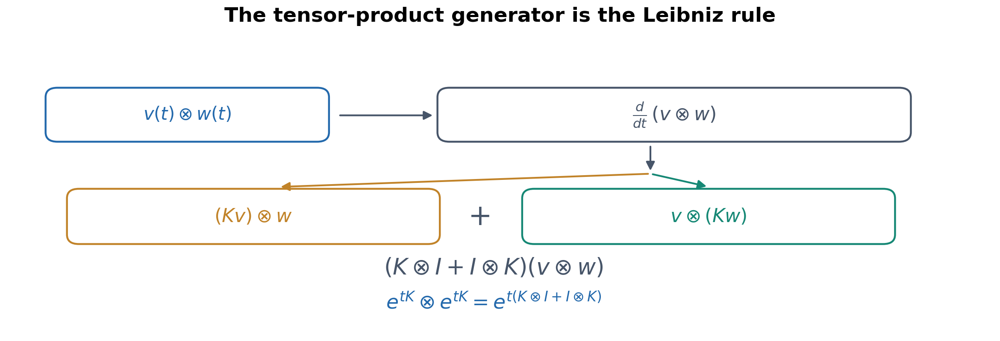

## — From Circular Modes and Linear Generators to Projective Representations and Tensor Actions

## Abstract

A Fourier series can combine many simple circular motions into an intricate curve. A neural network can likewise combine elementary function units to produce rich input–output relationships. These examples raise a common question: how much of a function's apparent complexity belongs to its elementary actions, and how much to the way those actions are combined and represented?

Starting with the exponential as the solution to a linear differential equation, this note develops the matrix exponential \( e^{tA} \). It uses two-dimensional generators satisfying \( A_\varepsilon^2=\varepsilon I \), with \( \varepsilon=-1,0,+1 \), to compare circular rotations, nilpotent shears, and hyperbolic transformations. Taking the ratio \( r=Y/X \) of two evolving components gives \( \dot r=1-\varepsilon r^2 \), showing how linear evolution produces \( \tan t \), \( t \), and \( \tanh t \) in projective coordinates. Fourier modes, Lorentz boosts, the logistic function, and `tanh` neural units enter at different points as mathematical examples. Induced generators on tensor products, higher derivatives, and a concise gradient calculation then clarify the relationships among dimension, tensor order, function representation, and learning dynamics.

By arranging established results into a derivation that can be checked step by step, this research note develops a cross-disciplinary route to understanding **how generators, representations, projections, and combinations shape the functions we observe**. The reader needs only basic familiarity with functions, matrix multiplication, and differentiation: generators are introduced through differential equations, projection through the slope \( Y/X \), and tensor products through pairwise products of vector components.

---

## 1. Starting with Two Familiar Kinds of Function Composition

### 1.1 How can circular motion draw a complicated curve?

A point moving uniformly around a circle of radius \( R \) and angular velocity \( \omega \) has coordinates

$$
(x(t),y(t))=(R\cos\omega t,R\sin\omega t).
$$

Combining the two coordinates into a complex number gives

$$
z(t)=x(t)+iy(t)=Re^{i\omega t}.
\tag{1.1}
$$

Now connect the endpoints of several rotating vectors head to tail. With an amplitude and phase attached to each mode, the resulting position can be written as

$$
z_N(t)=\sum_{n=-N}^{N}c_ne^{int}.
\tag{1.2}
$$

Each component simply rotates at a fixed rate, yet their combined endpoint can trace a detailed outline. The magnitude of each complex coefficient \( c_n \) sets the vector length, its argument sets the initial phase, and positive or negative \( n \) gives opposite rotation directions. Here \( t \) parameterizes a curve; for a closed contour we may naturally choose one full period. For periodic square-integrable functions, Fourier partial sums converge in the mean-square sense; sufficiently regular curves admit stronger convergence statements. Sharp corners and discontinuities introduced at periodic boundaries may require many high-frequency terms.

The central point is that **simple modes can carry elaborate shape information through their coefficients and composition**.

### 1.2 A different example: `tanh` function units

A single-hidden-layer neural network can be written as

$$
f_N(\mathbf x)=\sum_{a=1}^{m}v_a\tanh(\mathbf w_a\cdot\mathbf x+b_a)+c.
\tag{1.3}
$$

Each `tanh` unit first selects an input direction and scale through its weights, then produces a smooth S-shaped transition. Combining many such units yields complicated functions. Like Fourier synthesis, this uses a weighted sum of elementary functions; unlike a conventional Fourier expansion, however, it allows the directions \( \mathbf w_a \), offsets \( b_a \), and output coefficients \( v_a \) to be adapted. On suitable compact domains, well-known universal approximation results apply to single-hidden-layer networks with nonpolynomial activations.[1–3]

The two examples lead us toward a simpler underlying question: **why are trigonometric and hyperbolic functions both so closely connected to the natural exponential?** Understanding the action represented by an exponential, and then examining different ways of reading its output, provides a useful starting point.

## 2. From the Natural Exponential to the Matrix Exponential

### 2.1 The exponential solves the simplest continuous evolution law

Consider a scalar whose rate of change is proportional to its current value:

$$
\frac{dz}{dt}=az,\qquad z(0)=z_0.
$$

Its solution is \( z(t)=e^{at}z_0 \), because \( \frac{d}{dt}e^{at}=ae^{at} \). Equally important, adding two evolution intervals corresponds to composing their actions:

$$
e^{a(t+s)}=e^{at}e^{as}.
\tag{2.1}
$$

For a vector state \( \mathbf z(t) \), replace the scalar \( a \) with a linear operator, represented by a matrix \( A \):

$$
\frac{d\mathbf z}{dt}=A\mathbf z,\qquad \mathbf z(0)=\mathbf z_0.
\tag{2.2}
$$

The matrix exponential is defined by the convergent power series

$$
e^{tA}=I+tA+\frac{t^2A^2}{2!}+\frac{t^3A^3}{3!}+\cdots.
\tag{2.3}
$$

Term-by-term differentiation gives \( \frac{d}{dt}e^{tA}=Ae^{tA} \) and hence

$$
\boxed{\mathbf z(t)=e^{tA}\mathbf z_0.}
\tag{2.4}
$$

For a fixed matrix \( A \), the identity \( e^{(t+s)A}=e^{tA}e^{sA} \) still holds. We call \( A \) the **generator** of the continuous family of transformations and \( e^{tA} \) its finite action. This lets us examine a simple algebraic relation before asking what geometry or function it generates. Standard treatments of matrix exponentials and linear systems can be found in [8, 9].

### 2.2 Three two-dimensional generators distinguished by their squares

Consider the elementary family

$$
A_\varepsilon=\begin{pmatrix}0&\varepsilon\\1&0\end{pmatrix},
\qquad A_\varepsilon^2=\varepsilon I,
\qquad \varepsilon\in\{-1,0,+1\}.
\tag{2.5}
$$

Even powers reduce to \( \varepsilon^nI \), while odd powers reduce to \( \varepsilon^nA_\varepsilon \). Separating the matrix exponential into its even and odd terms yields

$$
e^{tA_\varepsilon}=C_\varepsilon(t)I+S_\varepsilon(t)A_\varepsilon
=\begin{pmatrix}C_\varepsilon(t)&\varepsilon S_\varepsilon(t)\\S_\varepsilon(t)&C_\varepsilon(t)\end{pmatrix}.
\tag{2.6}
$$

| \( \varepsilon \) | \( C_\varepsilon(t) \) | \( S_\varepsilon(t) \) | Geometric action |
|---:|---|---|---|
| \( -1 \) | \( \cos t \) | \( \sin t \) | Circular rotation (elliptic) |
| \( 0 \) | \( 1 \) | \( t \) | Shear (nilpotent/parabolic) |
| \( +1 \) | \( \cosh t \) | \( \sinh t \) | Hyperbolic transformation |

For \( \varepsilon=-1 \), the relation \( A^2=-I \) gives alternating signs among the even powers, generating \( \cos t \) and \( \sin t \). For \( \varepsilon=+1 \), there is no such sign alternation, and the resulting functions are \( \cosh t \) and \( \sinh t \). Euler's formula \( e^{it}=\cos t+i\sin t \) is the complex-number counterpart of the first case in a two-dimensional real representation.

There is a further connection that becomes clear at the level of scalar exponentials. Trigonometric and hyperbolic functions arise from combinations of imaginary and real exponentials, respectively:

$$
\cos t=\frac{e^{it}+e^{-it}}{2},\qquad
\cosh t=\frac{e^t+e^{-t}}{2}.
$$

On extending the argument to the complex plane, we obtain

$$
\boxed{\cos t=\cosh(it),\qquad
\sin t=-i\sinh(it),\qquad
\tanh(it)=i\tan t.}
$$

These relations express an **analytic continuation** between the two function families: changing a real argument to an imaginary one relates hyperbolic and trigonometric functions. Over the real two-dimensional state space, however, \( A_{-1}^2=-I \) and \( A_{+1}^2=I \) still generate different real matrix flows. One preserves a circular quadratic form and the other a hyperbolic one. Analytic formulas can be connected without erasing that geometric distinction.

### 2.3 Invariants make the geometry visible

Apply the three flows to the same initial vector:

$$
\begin{pmatrix}X(t)\\Y(t)\end{pmatrix}
=e^{tA_\varepsilon}\begin{pmatrix}1\\0\end{pmatrix}
=\begin{pmatrix}C_\varepsilon(t)\\S_\varepsilon(t)\end{pmatrix}.
\tag{2.7}
$$

The generator immediately gives

$$
\dot X=\varepsilon Y,\qquad \dot Y=X.
\tag{2.8}
$$

It follows that

$$
\frac{d}{dt}(X^2-\varepsilon Y^2)
=2X(\varepsilon Y)-2\varepsilon YX=0.
$$

The initial condition therefore fixes the invariant

$$
\boxed{X^2-\varepsilon Y^2=1.}
\tag{2.9}
$$

For \( \varepsilon=-1 \), this is the unit circle; for \( \varepsilon=0 \), the line \( X=1 \); and for \( \varepsilon=+1 \), the right-hand branch of a hyperbola. Distinct geometric trajectories emerge from the generator's square relation under identical initial conditions. All three matrices have zero trace, so their exponential matrices have determinant one and give basic one-parameter subgroups of \( SL(2,\mathbb R) \).

## 3. How a Two-Dimensional Linear Flow Produces a Nonlinear Function

### 3.1 Why examine \( Y/X \)?

Along the trajectories derived above, ask a different question: **what is the slope of the line from the origin to the moving point \( (X,Y) \)?**

Whenever \( X\ne0 \), that slope is

$$
\boxed{r(t)=\frac{Y(t)}{X(t)}.}
\tag{3.1}
$$

Extend the entire line through the origin and \( (X,Y) \) until it meets \( X=1 \). Its intersection point is \( (1,r) \). This gives a concrete picture of a projective coordinate. Multiplying both \( X \) and \( Y \) by the same nonzero scalar does not change the line of sight from the origin: projective coordinates retain a direction rather than the separate magnitudes of its components. We use the **slope of the line of sight**, not the tangent slope of the trajectory itself. When \( X=0 \), this coordinate chart fails and a different projective chart may be used.

*Figure 1. The planar trajectories of three matrix-exponential flows (top) and their projective slopes \( r=Y/X \) (bottom). From the same initial condition, the three generators produce a circle, a line, and a hyperbola; the corresponding readouts are \( \tan t \), \( t \), and \( \tanh t \). The indicated slope belongs to the line from the origin, not the curve's tangent.*

### 3.2 One quotient-rule calculation yields three equations

Using (2.8), differentiate \( r=Y/X \):

$$
\begin{aligned}
\dot r
&=\frac{X\dot Y-Y\dot X}{X^2}\\
&=\frac{X^2-\varepsilon Y^2}{X^2}\\
&=1-\varepsilon r^2.
\end{aligned}
\tag{3.2}
$$

Thus

$$
\boxed{
\begin{array}{c|c|c}
\varepsilon&r(t)&\dot r\\\hline
-1&\tan t&1+r^2\\
0&t&1\\
+1&\tanh t&1-r^2
\end{array}}
\tag{3.3}
$$

Changing the generator's square relation changes the nonlinear function seen in the ratio coordinate. The underlying \( (X,Y) \) evolution remains **linear**; the nonlinear differential equation arises from taking a ratio of its components. The poles of \( \tan t \) occur at \( X=0 \) and mark the boundary of this coordinate chart, not a divergence of the circular trajectory. By contrast, on the hyperbolic branch \( X(t)=\cosh t\ge1 \) never vanishes for real \( t \). Thus the projective readout \( \tanh t=Y/X \) is defined along the entire real axis and satisfies \( |\tanh t|<1 \). Its **lack of real poles and bounded output** help explain its use as a smooth activation function, though saturation also reduces gradients, as discussed in Section 9. The link to Section 2.2 becomes visible in the complex plane: \( \tanh z \) has poles at \( z=i(\pi/2+n\pi) \) for integers \( n \), away from the real axis, whereas \( \tan z \) has poles at \( z=\pi/2+n\pi \). These locations are related by analytic continuation.

### 3.3 General matrix flows and the Riccati equation

The same mechanism is not restricted to our three examples. Let

$$
A=\begin{pmatrix}a&b\\c&d\end{pmatrix},
\qquad
\begin{pmatrix}\dot X\\\dot Y\end{pmatrix}=A\begin{pmatrix}X\\Y\end{pmatrix}.
$$

Differentiating \( Y/X \) again gives

$$
\boxed{\dot r=c+(d-a)r-br^2.}
\tag{3.4}
$$

This is a Riccati equation. In other words, **the action of a two-dimensional linear flow on the projective line naturally produces a family of quadratic nonlinear equations**. For a dedicated treatment of Riccati differential equations, see Reid [10]; the projective reduction used here follows directly from the quotient-rule calculation above.

The parameter composition law of the three elementary functions also has a common form:

$$
\boxed{r(t+s)=\frac{r(t)+r(s)}{1+\varepsilon r(t)r(s)}.}
\tag{3.5}
$$

For \( \varepsilon=-1 \), \( 0 \), and \( +1 \) these are, respectively, the tangent addition formula, ordinary addition, and hyperbolic tangent addition formula. Each identity is understood where its denominators and chosen projective coordinates are valid.

## 4. Different Mathematical Readouts of the Same Hyperbolic Generator

### 4.1 From `tanh` to the logistic function

For the hyperbolic flow \( \varepsilon=+1 \), let \( K=A_{+1} \). Its action on \( (1,0)^T \) gives

$$
(X,Y)=(\cosh u,\sinh u),\qquad \frac{Y}{X}=\tanh u.
\tag{4.1}
$$

The logistic activation has the exact affine relationship

$$
\boxed{\sigma(u)=\frac{1}{1+e^{-u}}=\frac{1+\tanh(u/2)}{2}.}
\tag{4.2}
$$

The **eigenvector coordinates** of the hyperbolic flow make this clear: in diagonal coordinates, two independent components scale as \( e^{-u/2} \) and \( e^{u/2} \). Set \( p(u)=e^{-u/2} \) and \( q(u)=e^{u/2} \); normalizing these positive components to sum to \( 1 \) gives

$$
\sigma(u)=\frac{z_+(u)}{z_-(u)+z_+(u)},
\qquad \boxed{\sigma'(u)=\sigma(u)[1-\sigma(u)]}.
\tag{4.3}
$$

The logistic function takes values in \( (0,1) \), while `tanh` takes values in \( (-1,1) \). They can be regarded as readouts of a hyperbolic exponential action in different projective or normalized coordinates, with a factor of two in parameter scale. Coordinate choice also changes where the fixed points lie: at \( 0,1 \) for logistic, and at \( -1,1 \) for `tanh`.

### 4.2 Lorentz boosts: the quadratic-form-preserving readout

The same hyperbolic generator has a familiar role in a \( (1+1) \)-dimensional Minkowski metric. Let

$$
K=\begin{pmatrix}0&1\\1&0\end{pmatrix},\quad
\eta=\begin{pmatrix}1&0\\0&-1\end{pmatrix},\quad
\Lambda(u)=e^{uK}
=\begin{pmatrix}\cosh u&\sinh u\\\sinh u&\cosh u\end{pmatrix}.
$$

Since \( K^T\eta+\eta K=0 \), it follows that

$$
\boxed{\Lambda(u)^T\eta\Lambda(u)=\eta.}
\tag{4.4}
$$

This is a one-dimensional Lorentz boost parametrized by rapidity \( u \) (with sign conventions fixing the boost direction). Observing the full matrix action highlights **quadratic-form invariance**; taking the ratio of an evolving vector's components highlights the **projective `tanh` function**. They use the same hyperbolic generator while answering different mathematical questions.

For example, increasing the preactivation parameter by \( s \) gives

$$
\boxed{\tanh(u+s)=\frac{\tanh u+\tanh s}{1+\tanh u\,\tanh s}.}
\tag{4.5}
$$

This has the same fractional-linear form as one-dimensional relativistic velocity composition. In an ordinary neural unit, however, \( u \) is simply a real-valued preactivation; recognizing the common algebra does not require interpreting neural inputs as physical rapidities.

## 5. Acting on Tensors: How the Generator Extends to Higher Order

So far, \( e^{tA} \) has acted on a vector, such as the two-component state \( (X,Y) \). Consider instead the tensor product of two vectors, \( v\otimes w \). It can be viewed as an array of pairwise component products \( v^i w^j \), recording a bilinear relationship between the two vectors. This is not the same as changing the physical plane from two dimensions to four.

To understand **how the same linear action operates on several tensor slots**, we need only the familiar product rule.

Suppose two vectors satisfy

$$
\dot v=Av,\qquad\dot w=Aw.
$$

Differentiating their tensor product gives

$$
\begin{aligned}
\frac{d}{dt}(v\otimes w)
&=\dot v\otimes w+v\otimes\dot w\\
&=(A\otimes I+I\otimes A)(v\otimes w).
\end{aligned}
\tag{5.1}
$$

Thus, the generator induced on a second-order tensor product is

$$
\boxed{A^{(2)}=A\otimes I+I\otimes A,\qquad
 e^{tA^{(2)}}=e^{tA}\otimes e^{tA}.}
\tag{5.2}
$$

*Figure 2. The product rule expressed on a tensor product. The generator \( A \) acts on each slot separately, and the contributions add to form \( A\otimes I+I\otimes A \).*

For \( p \) contravariant slots, the generalization is

$$
\boxed{A^{(p)}=\sum_{j=1}^{p}I^{\otimes(j-1)}\otimes A\otimes I^{\otimes(p-j)}.}
\tag{5.3}
$$

For instance, a second-order contravariant tensor transforms as \( T'^{ij}=\Lambda^i{}_{\alpha}\Lambda^j{}_{\beta}T^{\alpha\beta} \). Covariant slots instead require the dual action; coordinate and metric conventions must be handled according to tensor type.

This separates three notions: the underlying vector-space dimension \( d \), the tensor order \( p \), and the full tensor-product space dimension \( d^p \). **Increasing tensor order increases the number of multilinear slots; it does not artificially increase the dimension of the original geometric space.**

The operator \( A^{(p)} \) in this section acts on a **tensor product of state spaces**, such as \( V^{\otimes p} \) for our two-dimensional flow. Section 7 will introduce \( q^{\otimes p} \), a symmetric covariant tensor arising from derivatives with respect to the **input variables**. The spaces and purposes differ. Their connection runs through a scalar function generated by the matrix flow and then differentiated with the chain rule; the two tensors are not identified with each other.

## 6. Returning to Fourier Analysis: Why Rotation Generators Fit Translation

Take the \( \varepsilon=-1 \) case from (2.5):

$$
J=\begin{pmatrix}0&-1\\1&0\end{pmatrix},\qquad J^2=-I.
$$

Its exponential is the two-dimensional rotation matrix

$$
e^{\theta J}=\begin{pmatrix}\cos\theta&-\sin\theta\\\sin\theta&\cos\theta\end{pmatrix}.
\tag{6.1}
$$

Identifying the plane with the complex plane gives the equivalent expression \( e^{i\theta} \). Fourier modes \( e^{ikx} \) therefore possess a particularly simple translation property: under \( x\mapsto x+a \) they acquire only a phase factor,

$$
e^{ik(x+a)}=e^{ika}e^{ikx}.
\tag{6.2}
$$

Thus, under the translation operator \( \mathsf T_a f(x)=f(x+a) \), a Fourier mode is an **eigenfunction** with eigenvalue \( e^{ika} \): translating its input changes only its complex phase. The same shift \( x\mapsto x+a \) acts quite differently on the `tanh` coordinate encountered in Section 4. Putting both readouts side by side makes their shared structure visible:

| Same shift: \( x\mapsto x+a \) | Fourier mode \( z=e^{ikx} \) | Hyperbolic projective coordinate \( r=\tanh x \) |
|---|---|---|
| After the shift | \( z'=e^{ika}z \) | \( r'=\dfrac{r+\tanh a}{1+r\tanh a} \) |
| Form of action | Phase rotation in the complex plane | Möbius action on the projective line |
| Composition of parameters | Phase angles \( ka \) add | Hyperbolic parameters \( a \) add |

Both represent the **additive group of real shifts** through a continuously composable family of actions: the first on complex amplitudes, the second on projective ratios. They share a composition law, not the same real linear transformation.

Fourier analysis exploits such modes to decompose a function into frequency components. In \( d \) dimensions, adopt the transform convention

$$
\widehat f(\mathbf k)=\int_{\mathbb R^d}f(\mathbf x)e^{-ik_i x^i}\,d^dx,
\qquad
f(\mathbf x)=\frac{1}{(2\pi)^d}\int_{\mathbb R^d}\widehat f(\mathbf k)e^{ik_i x^i}\,d^dk.
\tag{6.3}
$$

Here \( k_i x^i \) is the contraction of a covector with a vector. We initially assume sufficient regularity for the integrals and inversion to have their usual meaning; more general \( L^2 \) or distributional settings require their corresponding function-space formulations.

With kernel \( \mathcal K(\mathbf k,\mathbf x)=e^{-ik_i x^i} \), the Fourier transform is a linear integral operator; its discrete version can be written \( \widehat f_m=F_m{}^nf_n \). More importantly, under suitable boundary and regularity conditions,

$$
\boxed{\mathcal F[\partial_i f]=ik_i\widehat f,\qquad
\mathcal F[\partial_i\partial_j f]=-k_i k_j\widehat f.}
\tag{6.4}
$$

Differentiation becomes multiplication by frequency covectors and their outer products. This explains the usefulness of Fourier methods for translation-invariant linear differential problems; nonlinear products generally introduce convolutions and coupling between frequency modes.

## 7. The Shared Tensor Structure of Elementary Function Units

Fourier modes and `tanh` units can now be placed within the same functional form. Let the input be a vector \( \mathbf x \) in \( E=\mathbb R^d \), and let each covector \( q_a \) select a scalar input \( u_a \):

$$
\boxed{f(\mathbf x)=\sum_{a}c_a\phi_a(u_a),\qquad
u_a=q_{ai}x^i+b_a.}
\tag{7.1}
$$

This also clarifies how Sections 5 and 7 fit together. In Section 5, \( A^{(p)} \) acts on tensor products of the **state space** \( V \); here, derivatives with respect to \( \mathbf x \) produce tensors on the **input space** \( E \). When \( \phi_a(u_a)=\tanh u_a \), the scalar map is built by the sequence \( \mathbf x\to u_a\to(X(u_a),Y(u_a))\to Y(u_a)/X(u_a) \). The matrix flow supplies a scalar function, and the chain rule then describes its sensitivity to the input. The two kinds of tensors are connected by this construction, not identified with each other.

The function \( \phi_a \) may be a complex exponential, a sine, a hyperbolic tangent, or another sufficiently differentiable scalar function. First contract the input along a direction \( q_a \), then apply a scalar function, and finally form a weighted sum. These constructions are closely related to *ridge functions* in approximation theory.[2,4]

The chain rule gives the first derivative

$$
\partial_i f=\sum_a c_a\phi_a'(u_a)q_{ai},
$$

and the second derivative (the **Hessian**, which records how slopes change in different input directions)

$$
\boxed{\partial_i\partial_j f=\sum_a c_a\phi_a''(u_a)q_{ai}q_{aj}.}
\tag{7.2}
$$

A single unit contributes a scalar multiple of \( q_a\otimes q_a \) to the Hessian, so its matrix rank is at most one. Continuing to differentiate gives

$$
\boxed{\partial_{i_1}\cdots\partial_{i_p}f
=\sum_a c_a\phi_a^{(p)}(u_a)
q_{ai_1}\cdots q_{ai_p}.}
\tag{7.3}
$$

Here \( q_{ai_1}\cdots q_{ai_p} \) are the components of a symmetric order-\( p \) covariant tensor on the input space \( E \). This differs from the induced generator \( A^{(p)} \) in Section 5: the former records a function's sensitivity along input directions, whereas the latter describes a linear transformation acting on several tensor slots.

**Beyond the shared outer-product structure, the two function families have different derivative algebras.** For the Fourier unit \( \phi(u)=e^{iu} \),

$$
\phi^{(p)}(u)=i^p\phi(u).
$$

Each differentiation merely multiplies the mode by \( i \), making the exponential an eigenfunction of differentiation. For `tanh`, let \( h=\tanh u \). Section 3 gives \( h'=1-h^2 \), and another application of the chain rule yields

$$
\begin{aligned}
h''&=-2h(1-h^2),\\
h^{(3)}&=-2(1-h^2)(1-3h^2).
\end{aligned}
$$

Every derivative remains a polynomial in \( h \). Defining \( P_0(h)=h \), we obtain a recurrence that can be checked one step at a time:

$$
\boxed{P_{p+1}(h)=(1-h^2)\frac{dP_p(h)}{dh},\qquad
\frac{d^p}{du^p}\tanh u=P_p(\tanh u).}
$$

Thus a Fourier mode is differentiated by **multiplying the same mode by a constant**, whereas the derivatives of `tanh` are **generated as polynomials through its Riccati relation**. Both fit (7.3), but the scalar coefficients in front of the tensor outer products evolve differently. Closure here refers to the polynomial algebra under this differentiation rule; it does not assert that all derivatives lie in a fixed finite-dimensional linear space.

Keep the three counts distinct: the input dimension \( d \) counts components of \( \mathbf x \), the derivative tensor order \( p \) counts indices, and the number of units \( m \) counts terms in the sum. These formulas assume fixed affine coordinates, constant directions, and a single-stage composition; deeper networks or covariant derivatives require further chain-rule or connection terms.

## 8. A Useful Change of Representation: `tanh` Has a Fourier Integral

The hyperbolic tangent is odd and, for real \( x \), has the exact sine-integral representation

$$
\boxed{\tanh x=\int_0^\infty\frac{\sin(\omega x)}{\sinh(\pi\omega/2)}\,d\omega.}
\tag{8.1}
$$

This does not change the function's underlying mechanism; it describes the same curve in a different functional representation. A derivation begins with its integrable derivative:

$$
\frac{d}{dx}\tanh x=\operatorname{sech}^2x,\qquad
\mathcal F[\operatorname{sech}^2x](\omega)=\frac{\pi\omega}{\sinh(\pi\omega/2)}.
\tag{8.2}
$$

Fourier inversion, followed by integration in \( x \), yields (8.1); Appendix B checks the normalization factor. The derivative of a smooth transition has rapidly decaying high-frequency components. In contrast, **periodically extending** a finite segment of `tanh` creates endpoint jumps and therefore much more slowly decaying Fourier coefficients and Gibbs oscillations.

The example illustrates an important distinction: **a spectrum depends not only on a function's shape but also on its domain, boundary continuation, and whether the function or its derivative is being analyzed**.

## 9. From Function Derivatives to Parameter Updates: A Neural-Learning Example

Returning to (1.3), write the preactivation of one neuron as \( u^a=W^a{}_ix^i+b^a \) and its output as \( h^a=\tanh u^a \). The projective equation (3.2) directly yields

$$
\boxed{\frac{dh^a}{du^a}=1-(h^a)^2=\operatorname{sech}^2u^a.}
\tag{9.1}
$$

For large \( |u^a| \), this derivative tends toward zero: the familiar local gradient attenuation associated with `tanh` saturation. For \( y=v_ah^a+c \) and a single-sample squared loss \( L=\tfrac12(y-y_\ast)^2 \),

$$
\frac{\partial L}{\partial W^a{}_i}
=(y-y_\ast)v_a[1-(h^a)^2]x^i.
\tag{9.2}
$$

Calling the preceding scalar factor \( \delta_a \) gives

$$
\boxed{\nabla_W L=\boldsymbol\delta\otimes\mathbf x.}
\tag{9.3}
$$

For one sample, the weight-gradient matrix is an outer product of rank at most one; minibatches sum such outer products. Thus parameter learning also exposes an immediately identifiable tensor structure.

In an idealized continuous gradient flow, \( \dot\theta=-\nabla_\theta L \) implies

$$
\boxed{\frac{dL}{dt}=-\|\nabla_\theta L\|^2\le0.}
\tag{9.4}
$$

This is a loss-descent identity along gradient flow. Deeper questions about neural tangent kernels, spectral bias, and feature learning deserve separate treatment. Appendix C records only the minimal mathematical interface.[5–7]

Other common activations illustrate the same distinction between representation and mechanism. Sigmoid is an affine transform of `tanh`; SiLU, \( u\sigma(u) \), multiplies a linear factor by a smooth gate; ReLU has a piecewise-linear form; and exact GELU involves a Gaussian cumulative distribution. Their derivatives and compositional structures differ, making them natural subjects for a separate note on generating mechanisms and tensor coupling.

## 10. Returning to the Shared Mathematical Structure

The route from drawing curves to exponentials, matrix flows, projections, and tensors does not collapse distinct fields into one theory. Instead, it offers a more transparent way to identify the different levels at which mathematical actions occur.

| Mathematical level | Representative relation | What it reveals |
|---|---|---|
| Generator | \( \dot{\mathbf z}=A\mathbf z \) | Elementary linear evolution |
| Matrix exponential | \( e^{tA} \) | Finite actions and composition laws |
| Invariant structure | \( X^2-\varepsilon Y^2=1 \) | Preserved quadratic or degenerate constraints |
| Projective readout | \( r=Y/X \) | Nonlinear coordinate form of a linear flow |
| Modal synthesis | \( \sum c_a\phi_a \) | Complex shapes built from simple units |
| Induced tensor action | \( A\otimes I+I\otimes A \) | Actions distributed across tensor slots |
| Higher derivatives | \( \sum c_a\phi_a^{(p)}q_a^{\otimes p} \) | Symmetric outer-product structure |
| Parameter evolution | \( \dot\theta=-\nabla L \) | How function units change through learning |

Every row has concrete mathematical assumptions: projective coordinates require nonzero denominators, Fourier transforms depend on function spaces and boundary behavior, induced tensor representations depend on index type, and gradient descent depends on the loss and evolution rule. These conditions are part of the mathematical structure and make cross-disciplinary comparisons testable.

The natural next question is not which field secretly underlies all the others, but **which observed differences come from the generator, which from representation and readout, which from tensor composition, and which require additional dynamics and constraints**.

These questions can be addressed in separate research notes on generators and projective geometry; function products and composition; Fourier spectra and boundaries; parameter evolution of higher derivative tensors; and common symmetries, Noether-type relations, and Lyapunov constraints. Giving each topic one clear mathematical center will make their eventual connections easier to establish.

---

## Appendix A | Quick Checks of Riccati Dynamics and Composition Laws

From \( \dot X=\varepsilon Y \), \( \dot Y=X \), and \( r=Y/X \), one obtains, whenever \( X\ne0 \),

$$
\dot r=(X^2-\varepsilon Y^2)/X^2=1-\varepsilon r^2.
$$

The identity \( e^{(t+s)A}=e^{tA}e^{sA} \) combined with (2.6) gives

$$
C_\varepsilon(t+s)=C_\varepsilon(t)C_\varepsilon(s)+\varepsilon S_\varepsilon(t)S_\varepsilon(s),
$$

$$
S_\varepsilon(t+s)=S_\varepsilon(t)C_\varepsilon(s)+C_\varepsilon(t)S_\varepsilon(s).
$$

Taking their quotient yields (3.5). The general Riccati formula (3.4) follows by differentiating \( Y/X \) with \( \dot X=aX+bY \) and \( \dot Y=cX+dY \).

## Appendix B | The `tanh` Sine Integral and Its Normalization

Let \( g(x)=\operatorname{sech}^2x\in L^1(\mathbb R) \) and use the Fourier convention in (6.3):

$$
\widehat g(\omega)=\frac{\pi\omega}{\sinh(\pi\omega/2)}.
$$

Because \( \tanh x-\tanh0=\int_0^xg(s)\,ds \), Fourier inversion followed by integration gives

$$
\begin{aligned}
\tanh x
&=\frac{1}{2\pi}\int_{\mathbb R}\widehat g(\omega)
\frac{e^{i\omega x}-1}{i\omega}\,d\omega\\
&=\int_0^\infty\frac{\sin(\omega x)}{\sinh(\pi\omega/2)}\,d\omega.
\end{aligned}
$$

Combining positive and negative frequencies gives a factor of two, which cancels with \( 1/(2\pi) \) and the factor \( \pi \) from \( \widehat g \). Hence the prefactor of the final integral is \( 1 \). As a numerical cross-check:

| \( x \) | Sine integral | \( \tanh x \) |
|---:|---:|---:|
| \( 0.7 \) | \( 0.604367777117 \) | \( 0.604367777117 \) |
| \( 1.5 \) | \( 0.905148253645 \) | \( 0.905148253645 \) |

## Appendix C | Neural Tangent Kernels and Spectral Evolution: An Interface for Future Notes

For the squared loss

$$
L(\theta)=\frac12\int\bigl[f_\theta(x)-f_\ast(x)\bigr]^2\,d\mu(x),
$$

let \( \rho_\theta=f_\theta-f_\ast \) denote the prediction error. Gradient flow and the chain rule give

$$
\partial_t f_\theta(x)=-\int \Theta_\theta(x,x')\rho_\theta(x')\,d\mu(x'),
$$

where

$$
\Theta_\theta(x,x')=\sum_{\mu}\frac{\partial f_\theta(x)}{\partial\theta_\mu}
\frac{\partial f_\theta(x')}{\partial\theta_\mu}.
$$

If this kernel is fixed and translation invariant on a periodic domain with a compatible measure, Fourier modes can diagonalize its integral operator, yielding \( \partial_t\widehat\rho_n=-\lambda_n\widehat\rho_n \). In a general learnable finite-width network, the kernel changes with the parameters and may couple different frequencies; understanding this is a separate problem in learning dynamics.[5–7]

## Appendix D | References

1. **Cybenko, G. (1989).** “Approximation by Superpositions of a Sigmoidal Function.” *Mathematics of Control, Signals, and Systems*, 2, 303–314. [DOI](https://doi.org/10.1007/BF02551274).
2. **Barron, A. R. (1993).** “Universal Approximation Bounds for Superpositions of a Sigmoidal Function.” *IEEE Transactions on Information Theory*, 39(3), 930–945. [DOI](https://doi.org/10.1109/18.256500).
3. **Leshno, M., Lin, V. Ya., Pinkus, A., & Schocken, S. (1993).** “Multilayer Feedforward Networks with a Nonpolynomial Activation Function Can Approximate Any Function.” *Neural Networks*, 6(6), 861–867. [DOI](https://doi.org/10.1016/S0893-6080(05)80131-5).
4. **Candès, E. J. (1999).** “Harmonic Analysis of Neural Networks.” *Applied and Computational Harmonic Analysis*, 6(2), 197–218. [DOI](https://doi.org/10.1006/acha.1998.0248).
5. **Jacot, A., Gabriel, F., & Hongler, C. (2018).** “Neural Tangent Kernel: Convergence and Generalization in Neural Networks.” *NeurIPS 2018*. [Paper](https://papers.nips.cc/paper_files/paper/2018/hash/5a4be1fa34e62bb8a6ec6b91d2462f5a-Abstract.html).
6. **Rahaman, N., et al. (2019).** “On the Spectral Bias of Neural Networks.” *ICML 2019*. [PMLR](https://proceedings.mlr.press/v97/rahaman19a.html).
7. **Tancik, M., et al. (2020).** “Fourier Features Let Networks Learn High Frequency Functions in Low Dimensional Domains.” *NeurIPS 2020*. [Paper](https://proceedings.neurips.cc/paper_files/paper/2020/hash/55053683268957697aa39fba6f231c68-Abstract.html); **Sitzmann, V., et al. (2020).** “Implicit Neural Representations with Periodic Activation Functions.” *NeurIPS 2020*. [Paper](https://proceedings.neurips.cc/paper_files/paper/2020/hash/53c04118df112c13a8c34b38343b9c10-Abstract.html).
8. **Hall, B. C. (2015).** *Lie Groups, Lie Algebras, and Representations: An Elementary Introduction*, 2nd ed., Graduate Texts in Mathematics 222, Springer. [DOI](https://doi.org/10.1007/978-3-319-13467-3). — Background on matrix exponentials, generators, Lie groups, and representations.
9. **Teschl, G. (2012).** *Ordinary Differential Equations and Dynamical Systems*, Graduate Studies in Mathematics 140, American Mathematical Society. [DOI](https://doi.org/10.1090/gsm/140). — Background on linear systems, matrix exponentials, and dynamical systems.
10. **Reid, W. T. (1972).** *Riccati Differential Equations*, Mathematics in Science and Engineering 86, Academic Press. [Publisher](https://shop.elsevier.com/books/riccati-differential-equations/reid/978-0-12-586250-9). — Dedicated background on scalar and matrix Riccati differential equations.

### Further reading

11. **Chen, R. T. Q., Rubanova, Y., Bettencourt, J., & Duvenaud, D. (2018).** “Neural Ordinary Differential Equations.” *NeurIPS 2018*. [Paper](https://proceedings.neurips.cc/paper/2018/hash/69386f6bb1dfed68692a24c8686939b9-Abstract.html). — Further reading on continuous-depth neural networks.
12. **Ganea, O., Bécigneul, G., & Hofmann, T. (2018).** “Hyperbolic Neural Networks.” *NeurIPS 2018*. [Paper](https://papers.nips.cc/paper/7780-hyperbolic-neural-networks). — Further reading on hyperbolic-space architectures; its Poincaré geometry construction is not identical to the generator comparison made here.
