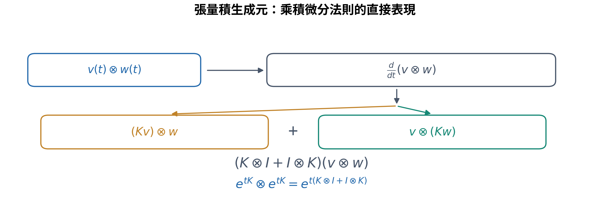
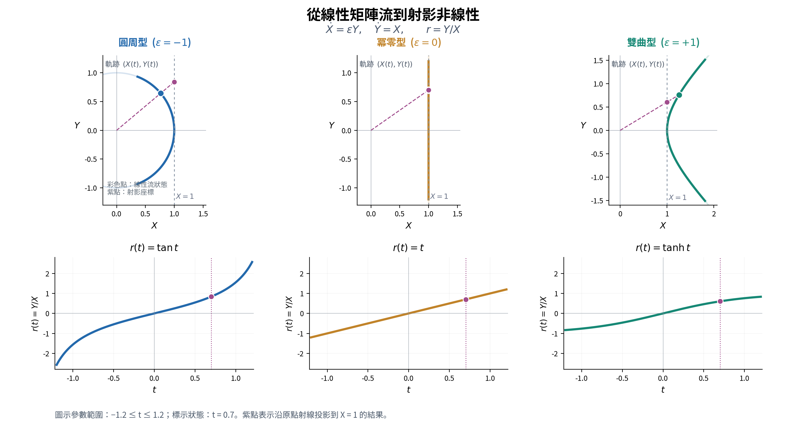

## ——從自然指數、生成元代數到射影表示與張量作用

> **本文定位**：這是一篇具有數學推導的研究札記，而非聲稱發現新定理的研究論文。主角是**自然指數所生成的線性作用、射影表示與張量結構**；傅立葉、Lorentz 轉換及神經單元只是相互對照的觀察窗口。本文把已知的矩陣指數、李群／射影作用、調和分析與函數微分放進一條可檢查的敘述路徑。其價值首先在**問題組織、跨領域的解釋視角與適用界線**，不主張這些基本恆等式具有原創性。

## 摘要

一個簡單的圓周模態，透過疊加可以逼近複雜曲線；另一個由雙曲函數構成的單元，也能用於逼近非線性函數。本文不以神經網路為研究主體，而是由這個對照回到自然指數與矩陣生成元，追問哪些數學作用是共同的，哪些性質取決於表示與觀測方式。以 \( A_\varepsilon^2=\varepsilon I \) 的二維生成元為核心，本文連接圓周旋轉、雙曲變換、冪零剪切及其射影動力學，並以 Lorentz boost 作為雙曲生成元的一個簡短對照，辨認同一線性流的二次型不變性與射影非線性讀出；高階張量誘導作用僅作為後續研究線索。傅立葉分析、`tanh` 函數與神經學習僅作為跨領域的具體案例，展示線性縮併、非線性讀出、高階導數與梯度作用如何在不同場景中出現。

文章核心觀察是：**非線性函數的外觀，未必對應同樣複雜的底層生成作用；線性矩陣流經由分量比值所形成的射影表示，可以呈現明確的非線性動力學。** 然而，這不能推論「所有非線性都只是表示假象」，也不能從雙曲函數的存在便宣稱神經網路具有 Lorentz 對稱性。本文刻意區分數學恆等式、已知理論與進一步研究的開放性問題。

---

## 1. 研究起點：從繪圖的圓周模態，走向可學習的函數單元

最初的直觀問題是：為什麼簡單的等速圓周運動，疊加後能畫出繁複線條？若將平面曲線寫為複數值函數

$$
z(t)=x(t)+iy(t),
$$

則一條適當參數化的閉合曲線可由傅立葉部分和逼近：

$$
z(t)\approx\sum_{n=-N}^{N}c_n e^{int}.
\tag{1.1}
$$

每個 \( e^{int} \) 只是固定角速度的旋轉模態；複雜性藏在係數與各模態的合成關係裡。對 \( L^2 \) 週期函數，其部分和在均方意義下收斂；若要求逐點或一致收斂，需要相應的附加正則性條件。

另一方面，使用 `tanh` 的單隱藏層網路可寫為

$$
f_N(\mathbf x)
=\sum_{a=1}^{m}v_a\tanh(\mathbf w_a\cdot\mathbf x+b_a)+c.
\tag{1.2}
$$

這兩個式子立即引發三個不同問題：

1. **表示問題**：不同基本函數是否可以共同寫成簡單的縮併與疊加？
2. **生成問題**：正弦、餘弦與 `tanh` 是否具有可比較的矩陣指數來源？
3. **學習問題**：神經網路改變權重時，是否能以張量與頻譜方式描述函數形狀的演化？

本文依序討論，而不將三種問題混成一個「等價性」主張。

## 2. 傅立葉：平移作用的模態表示

選用下列 \( d \) 維傅立葉轉換慣例：

$$
\widehat f(\mathbf k)
=\int_{\mathbb R^d}f(\mathbf x)e^{-ik_i x^i}\,d^d x,
\qquad
f(\mathbf x)
=\frac{1}{(2\pi)^d}
\int_{\mathbb R^d}\widehat f(\mathbf k)e^{ik_i x^i}\,d^d k.
\tag{2.1}
$$

這裡 \( k_i x^i \) 是對偶向量與向量的縮併；在通常的 Euclidean 直角座標下也寫成 \( \mathbf k\cdot\mathbf x \)。如果把積分視為連續索引的縮併，傅立葉轉換核為

$$
\mathcal K(\mathbf k,\mathbf x)=e^{-ik_i x^i},
\qquad
\widehat f(\mathbf k)
=\int\mathcal K(\mathbf k,\mathbf x)f(\mathbf x)\,d^dx.
\tag{2.2}
$$

有限維離散傅立葉轉換則是

$$
\widehat f_m=F_m{}^n f_n.
\tag{2.3}
$$

所以它可理解為一個線性映射；但「具有兩個索引的矩陣」不應直接等同於某個物理時空中的二階張量。此處的索引首先標記輸入與輸出表示空間。

傅立葉模態之所以特殊，在於平移作用：

$$
e^{ik(x+a)}=e^{ika}e^{ikx}.
\tag{2.4}
$$

因此複數指數是平移算子的本徵函數。對適當的函數與邊界條件，微分變成頻域的乘法：

$$
\mathcal F[\partial_i f]=ik_i\widehat f,
\qquad
\mathcal F[\partial_i\partial_j f]=-k_i k_j\widehat f.
\tag{2.5}
$$

這是傅立葉表示在微分方程中尤其有用的原因之一；不是因為它消除了所有複雜性，而是因為它在平移對稱的線性問題中，能有效對角化作用算子。

## 3. 神經單元：線性縮併後的非線性映射

設輸入向量為 \( x^i \)，神經單元 \( a \) 的預激活量與輸出為

$$
u^a=W^a{}_i x^i+b^a,
\qquad
h^a=\tanh(u^a).
\tag{3.1}
$$

一個線性輸出層給出

$$
y=v_a h^a+c.
\tag{3.2}
$$

在固定座標與內積慣例下，\( W^a{}_i \) 是從輸入空間到隱藏層空間的線性映射分量。`tanh` 則逐分量作用，**通常不會在任意隱藏層基底變換下仍保有相同的逐分量形式**。這一點是討論一般張量協變性時的重要限制。

單隱藏層 `tanh` 網路具有普遍逼近能力：對適當緊緻定義域中的連續函數，可以使用足夠多的單元，在一致範數下達成任意精度的逼近。然而，**存在某組參數**不代表一般訓練演算法必然找到該組參數，也不代表所需單元數在所有高維問題中都很小。[1–3]

從表示形式看，傅立葉合成與單隱藏層網路都屬於

$$
\boxed{
 f(\mathbf x)=\sum_a c_a\,\phi_a(q_{ai}x^i+b_a)
}
\tag{3.3}
$$

這一類函數合成，但不能因此忽略固定基底與可學習參數的差異。

## 4. 回到自然指數：三種二維生成元

為了把三角函數與雙曲函數的關係看得更清楚，考慮以下統一生成元。須先區分：自然指數函數本身並不是張量；當指數作用於線性算子或其誘導表示時，才形成可在不同張量空間中研究的變換：

$$
A_\varepsilon=
\begin{pmatrix}0&\varepsilon\\1&0\end{pmatrix},
\qquad
A_\varepsilon^2=\varepsilon I,
\qquad
\varepsilon\in\{-1,0,+1\}.
\tag{4.1}
$$

矩陣指數由冪級數定義：

$$
e^{tA_\varepsilon}
=\sum_{n=0}^{\infty}\frac{t^n A_\varepsilon^n}{n!}.
\tag{4.2}
$$

將偶數冪與奇數冪分開後，可以寫成

$$
e^{tA_\varepsilon}
=\begin{pmatrix}
C_\varepsilon(t)&\varepsilon S_\varepsilon(t)\\
S_\varepsilon(t)&C_\varepsilon(t)
\end{pmatrix},
\tag{4.3}
$$

其中

| \( \varepsilon \) | \( C_\varepsilon(t) \) | \( S_\varepsilon(t) \) | 生成元型態 | 幾何直觀 |
|---|---|---|---|---|
| \( -1 \) | \( \cos t \) | \( \sin t \) | 橢圓型（elliptic） | 圓周旋轉 |
| \( 0 \) | \( 1 \) | \( t \) | 拋物型（parabolic） | 剪切／冪零流 |
| \( +1 \) | \( \cosh t \) | \( \sinh t \) | 雙曲型（hyperbolic） | 雙曲變換 |

三種 \( A_\varepsilon \) 都具有零跡，因而 \( \det e^{tA_\varepsilon}=1 \)，屬於 \( SL(2,\mathbb R) \) 的單參數子群。這是既有李群理論中很基本的分類範例，不是新構造。

取初始向量 \( (1,0)^T \)：

$$
\begin{pmatrix}X(t)\\Y(t)\end{pmatrix}
=e^{tA_\varepsilon}
\begin{pmatrix}1\\0\end{pmatrix}
=\begin{pmatrix}C_\varepsilon(t)\\S_\varepsilon(t)\end{pmatrix}.
\tag{4.4}
$$

它滿足

$$
\dot X=\varepsilon Y,
\qquad
\dot Y=X,
\qquad
X^2-\varepsilon Y^2=1.
\tag{4.5}
$$

對 \( \varepsilon=-1 \)，最後一式是圓周不變量 \( X^2+Y^2=1 \)；對 \( \varepsilon=+1 \)，是雙曲不變量 \( X^2-Y^2=1 \)；對 \( \varepsilon=0 \)，它退化為 \( X^2=1 \)，描述冪零流的特殊情況。這裡的「不變量」屬於指定的矩陣群作用，不能未經論證就當作任意物理系統的守恆量。

### 4.1 雙曲生成元的不同表示：Lorentz boost 與 `tanh`

雙曲型生成元有兩種很容易互相對照、但不能混為同一個物理命題的讀法。令

$$
K=A_{+1}=\begin{pmatrix}0&1\\1&0\end{pmatrix},
\qquad \eta=\begin{pmatrix}1&0\\0&-1\end{pmatrix},
\qquad
\Lambda(t)=e^{tK}=\begin{pmatrix}\cosh t&\sinh t\\\sinh t&\cosh t\end{pmatrix}.
$$

因 \( K^T\eta+\eta K=0 \)，有

$$
\boxed{\Lambda(t)^T\eta\Lambda(t)=\eta.}
\tag{4.6}
$$

**線性作用的讀法**：在 \( (1+1) \) 維 Minkowski 度規與本文符號慣例下，這就是以快度為參數的一維 Lorentz boost。**射影讀出的讀法**：同一矩陣流作用於 \( (1,0)^T \)，得到 \( X=\cosh t \)、\( Y=\sinh t \)；取比值 \( h(t)=Y/X=\tanh t \)。參數再增加 \( s \) 時，

$$
\boxed{h(t+s)=\frac{h(t)+\tanh s}{1+h(t)\tanh s}}.
\tag{4.7}
$$

這是 Möbius 分式線性作用，也與一維相對論速度合成律具有相同的代數形式（相對速度的方向與正負號仍依慣例而定）。對一般 `tanh` 神經單元，\( t=w_ix^i+b \)、\( s \) 可以只是預激活量的增量；**此處沒有把神經網路的輸入當成物理快度，也沒有宣稱網路具有 Lorentz 等變性**。式 (4.7) 的三分流版本見後面的式 (5.4)。

為保留張量研究主線，僅記下一個誘導表示：若 \( T^{ij} \) 是二階逆變張量，則

$$
\begin{aligned}
T'^{ij}&=\Lambda^i{}_p\Lambda^j{}_qT^{pq},\\
\Lambda^{\otimes2}&=e^{t(K\otimes I+I\otimes K)}.
\end{aligned}
\tag{4.8}
$$

這裡的生成元加總 \( K\otimes I+I\otimes K \)，本質上就是**乘積微分法則（Leibniz rule）在張量積上的表現**：當 \( \dot v=Kv \)、\( \dot w=Kw \)，對 \( v\otimes w \) 求時間導數，會讓 \( K \) 分別作用在兩個張量槽位上。

*圖 1．張量積的誘導生成元。\( v\otimes w \) 的時間導數分成 \( (Kv)\otimes w+v\otimes(Kw) \)，因此得到 \( K\otimes I+I\otimes K \)。生成元逐一作用於張量槽位，並未改變底層向量空間的維度。*

這說明同一生成元可以提升到較高階的張量作用，但**張量階數的增加不等於原空間維度的增加**。一般 \( r \) 階及混合協、逆變指標的完整誘導表示，另留給專門的張量札記；本文不在此展開相對論主題。

## 5. 核心推導：線性矩陣流如何成為非線性射影動力學

現在只觀察兩個分量的比值

$$
r(t)=\frac{Y(t)}{X(t)},\qquad X(t)\ne0.
\tag{5.1}
$$

**幾何直觀。** \( r(t) \) 是從原點連到運動點 \( (X(t),Y(t)) \) 的**射線斜率**。當 \( X(t)\ne0 \) 時，沿這條直線與 \( X=1 \) 相交，便得到 \( (1,r(t)) \)；換句話說，我們是以射影座標讀取二維的線性軌跡。這裡的 \( Y/X \) **不是軌跡本身的切線斜率**。

*圖 2．相同初始條件 \( (X(0),Y(0))=(1,0) \) 下的線性矩陣流（上排）及射影函數（下排）：圓周型（藍色）對應 \( r=\tan t \)、冪零型（橘色）對應 \( r=t \)、雙曲型（綠色）對應 \( r=\tanh t \)。虛線射線與紫色標記表示 \( t=0.7 \) 時投影至 \( X=1 \) 的幾何讀出。圖示範圍為 \( -1.2\le t\le1.2 \)；圓周流在 \( X=0 \) 處的 \( \tan t \) 極點位於此區間之外，它是射影座標圖的奇異點，而非底層圓周軌跡發散。*

使用商數微分法則及式 (4.5)：

$$
\begin{aligned}
\dot r
&=\frac{X\dot Y-Y\dot X}{X^2}\\
&=\frac{X^2-\varepsilon Y^2}{X^2}\\
&=1-\varepsilon r^2.
\end{aligned}
\tag{5.2}
$$

因此三種情況自然給出：

$$
\boxed{
\begin{array}{c|c|c}
\varepsilon&r(t)&\dot r(t)\\\hline
-1&\tan t&1+r^2\\
0&t&1\\
+1&\tanh t&1-r^2
\end{array}
}
\tag{5.3}
$$

其中 \( \tan t \) 的表示僅在 \( \cos t\ne0 \) 的射影座標圖上成立；跨越其極點需要更換射影座標圖。

**整理性命題（已知結果的基本特例）：** 由滿足 \( A_\varepsilon^2=\varepsilon I \) 的線性矩陣流 \( e^{tA_\varepsilon} \)，在適當分量比值座標中可誘導 Riccati 型動力學 \( \dot r=1-\varepsilon r^2 \)。

這裡的「非線性」是指在 \( r \) 座標中的演化方程出現二次項；底層 \( (X,Y) \) 的演化仍然是線性的。兩種敘述不矛盾，因為我們已更換了表示變數。這也不表示所有非線性系統都能經由有限維線性化消除其非線性。

甚至它們的參數合成律也具有共同形式：

$$
\boxed{
 r(t+s)=\frac{r(t)+r(s)}{1+\varepsilon r(t)r(s)}
}
\tag{5.4}
$$

這個公式適用於分母不為零且相關射影座標有效的情況；它分別包含正切加法、線性加法與雙曲正切加法。

### 5.1 一般線性生成元如何給出 Riccati 方程

若使用任意常數矩陣

$$
A=\begin{pmatrix}a&b\\c&d\end{pmatrix},
\qquad
\frac{d}{dt}\begin{pmatrix}X\\Y\end{pmatrix}
=A\begin{pmatrix}X\\Y\end{pmatrix},
$$

則 \( r=Y/X \) 滿足

$$
\boxed{\dot r=c+(d-a)r-br^2.}
\tag{5.5}
$$

因此前述的三分流不是偶然的函數巧合，而是二維線性流在射影直線上的標準作用結構。[8]

### 5.2 Sigmoid：相同雙曲流的另一個射影讀出

常見 Logistic 函數與雙曲正切的精確關係為

$$
\boxed{\sigma(u)=\frac{1}{1+e^{-u}}
=\frac{1+\tanh(u/2)}2.}
\tag{5.6}
$$

可從雙曲流的本徵座標直接看出這個關係。令 \( p(u)=e^{-u/2} \)、\( q(u)=e^{u/2} \)，則 \( (p,q)^T \) 是對角生成元 \( B=\operatorname{diag}(-1/2,1/2) \) 所產生的線性流；取正規化分量

$$
\boxed{s(u)=\frac{q(u)}{p(u)+q(u)}=\sigma(u),
\qquad \frac{ds}{du}=s(1-s).}
\tag{5.7}
$$

若改用 \( X=(p+q)/2 \)、\( Y=(q-p)/2 \)，就有 \( r=Y/X=\tanh(u/2) \)，且 \( s=(1+r)/2 \)。這是雙曲線性作用在不同射影讀出、及不同參數尺度下的表現：\( r \) 的不動點為 \( \{-1,1\} \)，\( s \) 的不動點為 \( \{0,1\} \)。這裡的仿射變換也是 Möbius 變換的特例。

此例的用意在於辨認**生成元、座標選擇及非線性讀出**的不同角色。Softmax 的高維正規化與單純形幾何具有可比性，但其多維結構宜另成一篇札記，本文不在此展開。

## 6. 對 tanh 神經單元而言，射影表示直接接上了學習梯度

現在把 \( t \) 換成神經單元的預激活量

$$
u=w_i x^i+b.
\tag{6.1}
$$

在 \( \varepsilon=+1 \) 的雙曲型情況：

$$
\begin{pmatrix}X\\Y\end{pmatrix}
=e^{uA_{+1}}\begin{pmatrix}1\\0\end{pmatrix}
=\begin{pmatrix}\cosh u\\\sinh u\end{pmatrix},
\quad
h=\frac{Y}{X}=\tanh u.
\tag{6.2}
$$

由式 (5.2)：

$$
\boxed{
\frac{dh}{du}
=1-h^2
=\frac{1}{X^2}
=\operatorname{sech}^2u
}
\tag{6.3}
$$

這裡得到一個格外清楚的連結：**神經單元導數的門控因子 \( 1-h^2 \)，正是雙曲矩陣流之射影座標的變化率。** 當 \( |u| \) 很大時，\( X=\cosh u \) 變大，於是 \( 1/X^2 \) 變小，呈現熟知的 `tanh` 飽和與梯度抑制。

它是一個可直接檢驗的恆等式，但不應寫成新發現的神經學習規律。

對單筆資料，若網路為

$$
y=v_a h^a+c,
\qquad
L=\frac12(y-y_\ast)^2,
\qquad
e=y-y_\ast,
\tag{6.4}
$$

則由鏈式法則

$$
\frac{\partial L}{\partial W^a{}_i}
=e\,v_a\bigl[1-(h^a)^2\bigr]x^i.
\tag{6.5}
$$

設

$$
\delta_a=e\,v_a\bigl[1-(h^a)^2\bigr],
$$

便有

$$
\boxed{
\frac{\partial L}{\partial W^a{}_i}=\delta_a x^i.
}
\tag{6.6}
$$

也就是單筆資料的權重梯度為一個向量外積（秩至多為一）；小批次更新是此類外積的加總。此處的「外積張量」是由梯度運算導出的代數結構，不代表整個多層學習動力學都是線性的。

### 6.1 激活函數只是觀察窗口：飽和、門控與其他生成機制

`tanh` 的兩端飽和，使 \( h'=1-h^2\to0 \)；Sigmoid 同樣具有飽和導數。這說明基本函數的導數性質會影響梯度傳播，但深層網路的梯度也取決於權重矩陣與層間 Jacobian 的組合。現代常見的 SiLU（Swish）是一個簡潔的延伸例子：

$$
\phi_{\mathrm{SiLU}}(u)=u\sigma(u),\qquad
\phi_{\mathrm{SiLU}}'(u)
=\sigma(u)+u\sigma(u)(1-\sigma(u)).
\tag{6.7}
$$

它把近似線性的通道與平滑門控相乘；正向大輸入時斜率趨近 \( 1 \)。ReLU 的分段線性作用、GELU 的**高斯累積分布**門控，以及多通道乘積架構，則各有不同的精確數學機制；GELU 的 `tanh` 寫法只是常用近似，不能宣稱它們全都由同一個二維常係數雙曲生成元產生。本篇到此為止，相關分類、乘積張量及訓練特質保留為其他獨立札記。

## 7. 共同的高階導數張量骨架

考慮一般形式

$$
f(\mathbf x)=\sum_a c_a\phi_a(u_a),
\qquad u_a=q_{ai}x^i+b_a.
\tag{7.1}
$$

由重複使用鏈式法則，在固定仿射座標與常數 \( q_{ai} \) 下：

$$
\boxed{
\partial_{i_1}\cdots\partial_{i_r}f
=\sum_a c_a\phi_a^{(r)}(u_a)
q_{ai_1}\cdots q_{ai_r}.
}
\tag{7.2}
$$

對二階導數尤其清楚：

$$
H_{ij}
=\sum_a c_a\phi_a''(u_a)q_{ai}q_{aj}.
\tag{7.3}
$$

傅立葉單元 \( \phi(u)=e^{iu} \) 給出

$$
H^{(F)}_{ij}
=-\sum_a c_a e^{iu_a}k_{ai}k_{aj};
\tag{7.4}
$$

`tanh` 單元 \( \phi(u)=\tanh u \) 則給出

$$
H^{(N)}_{ij}
=\sum_a v_a\tanh''(u_a)w_{ai}w_{aj}.
\tag{7.5}
$$

每個非零單元項都具有對稱秩一的外積形式；由多項相加後，整體 Hessian 的秩可以更高。更高階亦可由 \( q_a^{\otimes r} \) 表示。

必須分清以下三件事：

- **輸入維度 \( d \)**：\( \mathbf x \) 所在向量空間的維度。
- **張量階數 \( r \)**：此處表示對輸入求導的次數，對應 \( r \) 個指標。
- **模態數／神經單元數 \( m \)**：參與相加的項數，不是張量階數。

這個區分對多維函數逼近與張量研究都很重要。但如果加入多層複合、位置依賴的權重、非線性座標變換或曲流形協變導數，式 (7.2) 就不能不加條件地沿用；屆時會出現額外的鏈式法則或連接項。

## 8. tanh 的傅立葉表示：可以轉換，但不等於學習過程相同

`tanh` 是奇函數，因而其適當的正弦積分表示可以寫為

$$
\boxed{
\tanh x
=\int_0^\infty\frac{\sin(\omega x)}{\sinh(\pi\omega/2)}\,d\omega.
}
\tag{8.1}
$$

其中 \( x \) 為實數；這是連續頻率的積分表示，而非離散週期傅立葉級數。需注意 \( \tanh x \) 在整條實線上不屬於 \( L^1 \) 或 \( L^2 \)；嚴謹處理其傅立葉轉換時可先處理導數，或採分布的觀點。

由

$$
\frac{d}{dx}\tanh x=\operatorname{sech}^2x,
$$

依式 (2.1) 的轉換慣例，有

$$
\boxed{
\mathcal F[\operatorname{sech}^2x](\omega)
=\frac{\pi\omega}{\sinh(\pi\omega/2)}.
}
\tag{8.2}
$$

高頻 \( |\omega|\to\infty \) 時，右側以指數速度衰減。若單元改成 \( \tanh(wx+b) \)，其尺度與平移會改變所隱含的頻率權重及相位；但這並不是說權重學習等價於逐頻率獨立調整傅立葉係數。

還有一項看似矛盾、實則十分重要的差異：

- 在整條實線上研究平滑的 `tanh` 導數，其傅立葉振幅具有快速高頻衰減。
- 若把區間 \( [-\pi,\pi] \) 的 `tanh` 取樣後直接做**週期延拓**，兩端產生跳躍接縫；其正弦級數係數便通常只有 \( O(1/n) \) 的衰減，並在接縫附近呈現 Gibbs 現象。

所以討論「高頻受限」時，必須先說清楚**函數空間、邊界條件、所觀察的函數／導數，以及頻譜範圍**。單由平滑 `tanh` 的特性，不能直接宣稱物理系統具有高頻截止。

## 9. 從表示走向學習：梯度流與頻譜演化

傅立葉係數通常是在指定的基底中分析函數；神經網路則會改變單元方向 \( w_{ai} \)、位置 \( b_a \) 與組合權重 \( v_a \)。若將所有參數統稱為 \( \theta \)，連續梯度流為

$$
\dot\theta=-\nabla_\theta L.
\tag{9.1}
$$

對足夠光滑的損失函數，沿精確梯度流有

$$
\frac{dL}{dt}
=\nabla_\theta L\cdot\dot\theta
=-\|\nabla_\theta L\|^2\le0.
\tag{9.2}
$$

這是一個李雅普諾夫型下降關係；但它只保證損失沿理想梯度流非增加，**不自動保證參數收斂至全域最優解**。若使用離散步長、動量、噪聲、非光滑操作或時變資料，仍需另行檢驗穩定性。

考慮平方損失

$$
L(\theta)=\frac12\int
\bigl[f_\theta(x)-f_\ast(x)\bigr]^2\,d\mu(x)
$$

及誤差 \( e_\theta(x)=f_\theta(x)-f_\ast(x) \)。鏈式法則給出

$$
\partial_t f_\theta(x)
=-\int K_\theta(x,x')e_\theta(x')\,d\mu(x'),
\tag{9.3}
$$

其中

$$
\boxed{
K_\theta(x,x')
=\sum_p
\frac{\partial f_\theta(x)}{\partial\theta_p}
\frac{\partial f_\theta(x')}{\partial\theta_p}.
}
\tag{9.4}
$$

這是有限維參數下的神經切線核（NTK）表示，相關理論已有成熟研究。[5]

**只有在附加條件下**，我們才可將學習的誤差動力學簡化為逐頻率演化：例如在週期空間中，使用平移不變的測度，並且核固定、平移不變，\( K(x,x')=\kappa(x-x') \)。此時傅立葉模態對角化核算子：

$$
\partial_t\widehat e_n(t)
=-\lambda_n\widehat e_n(t),
\qquad
\widehat e_n(t)=e^{-\lambda_n t}\widehat e_n(0).
\tag{9.5}
$$

但在一般有限寬度、特徵學習中的網路，\( K_\theta \) 可能隨訓練改變，也不必然平移不變；頻率之間可能耦合。所謂頻譜偏向（spectral bias）是特定架構、初始化、資料與訓練條件下的重要現象，並非無條件普遍定律。[6–7]

## 10. 對稱性與拘束：兩者相似處的界線

這一輪比較至少需要區分四個層次：

| 層次 | 傅立葉 | `tanh` 神經單元 | 不宜混淆之處 |
|---|---|---|---|
| 基本生成 | 複數指數／旋轉生成元 | 雙曲生成元的射影比值 | 函數同源不等於作用等價 |
| 對稱結構 | 平移模態可對角化 | 平移可由偏置改變表示 | 參數族封閉不等於每一單元是本徵函數 |
| 張量結構 | \( k^{\otimes r} \) | \( w^{\otimes r} \) | 模態數不等於張量階數 |
| 動力學 | 傅立葉變換本身無訓練 | 權重受損失梯度驅動 | 表示能力不等於學習機制 |

上述比較只針對本文選定的兩類函數單元；第 5.2 節的 Logistic 正規化與第 6.1 節的 SiLU 門控，是為了顯示同一類指數結構可有不同讀出與組合方式，**並非激活函數的一般分類定理**。

### 10.1 關於 Lorentz 類比

第 4.1 節引用 Lorentz boost，只為展示**同一雙曲生成元的兩種讀出**：線性矩陣 \( e^{tK} \) 保存二次型 \( X^2-Y^2 \)，而分量比值 \( Y/X \) 給出 `tanh`，參數相加則在比值座標中表現為 Möbius 作用。式 (4.8) 順帶提示生成元可誘導高階張量表示，而不是本文的物理推導主軸。

一般神經單元中的 \( w_i \)、偏置與逐分量 `tanh` **不會僅憑這些公式就滿足 Lorentz 協變性、物理上的速度合成律或守恆定律**。數學上的生成元同型，必須與具體物理量、度規及對稱要求清楚區分。

### 10.2 關於「非線性只是投影」

`tanh` 可由線性矩陣流經射影座標得到，但這不能倒推出所有非線性動力學都可由有限維線性系統完全表示。更不能抹除多層網路的函數複合、訓練與正則化所帶來的非線性效應。

### 10.3 關於高頻與自然界

數學表示中的頻譜快速衰減，可能源於光滑性、解析性、邊界或基底選擇；物理上的容許頻譜則需要具體動力學、能量泛函與邊界條件推導。兩者有可比較的形式，但不可直接畫上等號。

## 11. 研究觀察與後續可檢驗問題

本文目前最值得保留的結果，並不是新公式，而是以下具體的結構串接：

$$
\boxed{
\begin{gathered}
A_\varepsilon^2=\varepsilon I
\quad\longrightarrow\quad
e^{tA_\varepsilon}\\[2mm]
\downarrow\\[-1mm]
(X,Y)\ \text{的線性演化及二次型不變量}\\[2mm]
\downarrow\\[-1mm]
r=Y/X,\quad \dot r=1-\varepsilon r^2\\[2mm]
\downarrow\\[-1mm]
\text{圓周／線性／雙曲函數表示}\\[2mm]
\downarrow\\[-1mm]
\text{函數單元疊加、張量導數與學習梯度}
\end{gathered}
}
\tag{11.1}
$$

以下問題值得後續拆成獨立研究節點，本文並未解決這些問題。

**問題 A｜生成元分類與函數族：** 對更一般的矩陣生成元、特定子群及不同射影空間，能否建立適合函數逼近的清晰分類？哪些條件只是座標描述，哪些對應真正不變的代數特徵？

**問題 B｜高階導數張量的演化：** 對 \( f_\theta \) 及 \( \dot\theta=-\nabla L \)，能否明確寫下 \( \partial_t\nabla_x^r f_\theta \)，並檢視單隱藏層的對稱外積分解在多層網路中如何改變？

**問題 C｜頻譜與張量耦合：** 比較模型學習中 \( w_a^{\otimes r} \) 的方向及係數變化與 \( \widehat f_\theta(k) \) 的頻譜變化，尋找可量測的關係，而不預設逐頻率獨立演化。

**問題 D｜共同對稱的相容條件：** 若一個網路需要保留旋轉、平移或其他群作用，哪些權重約束、表示選擇及激活機制是必要的？逐分量 `tanh` 如何與指定群表示相容？

**問題 E｜能量與學習穩定性：** 以損失泛函作為下降量，辨別梯度流的李雅普諾夫性質、真正的對稱守恆量（Noether 類結構）及函數空間中的可容許集合，避免將它們混作同一種「共同拘束」。

這五個問題僅作為**未來獨立研究札記的入口**：其中生成元與射影幾何、函數乘積與張量結構、傅立葉頻譜、學習演化、共同對稱與拘束，應各自先處理一個清楚的數學命題，不在本篇合併成「神經學習的統一理論」。

### 11.1 最小數值實驗規劃（部分已核對）

1. 在同一圖中比較 \( e^{tA_{-1}} \)、\( e^{tA_0} \)、\( e^{tA_{+1}} \) 的 \( (X,Y) \) 與 \( r=Y/X \)，檢查式 (5.3)（已完成圖 2 的數值繪圖對照；這是既有恆等式的幾何視覺化，並非新的數值研究結果）。
2. 數值核對 \( \tanh'(u)=1/\cosh^2u \)，並顯示飽和區域的梯度抑制。
3. 用相同目標函數比較有限傅立葉合成與單隱藏層 `tanh` 的逼近；分別記錄參數量、誤差與頻譜，而非只比較函數圖形。
4. 對指定資料訓練小型網路，追蹤 \( \widehat f_\theta(k) \) 與 Hessian 的特徵值；檢查何種條件下能觀察到近似逐頻率下降。

目前已完成圖 2 的三種矩陣流幾何對照，以及附錄 B 的 `tanh` 正弦積分常數因子核對；這兩項都不是神經網路訓練實驗，其餘模型比較仍未執行。

## 12. 本版結論與文章定位

本篇想呈現的核心思想是：**一個複雜函數的外觀，不能直接代表生成它的作用規則同樣複雜。** 以自然指數與生成元代數為起點，圓周模態、雙曲線性流及其 Lorentz 對照、射影 `tanh`／Logistic 表示、張量導數與簡要的誘導作用，可以由少數明確的代數和微分關係串接起來。神經網路的梯度只是幫助讀者看見這種結構在另一個領域如何出現的例子。

但「同一組數學工具可以描述多種對象」與「多種對象具有相同的物理或學習機制」是兩回事。本文最大的價值在於提供一條**可讀、可驗證、且適合跨領域比較的數學解釋路徑**，而不是提出新激活函數、新網路架構或新定理。

文中的兩張幾何示意圖，使生成元與射影讀出的對應更加直觀。本文尚未處理嚴格的函數空間條件與系統性的文獻重疊分析，也還沒有提出具可檢驗新增推論的研究問題。

---

## 附錄 A｜射影導數的快速核對

從

$$
\dot X=\varepsilon Y,\qquad \dot Y=X,
\qquad X(0)=1,\quad Y(0)=0,
$$

得 \( \frac{d}{dt}(X^2-\varepsilon Y^2)=0 \)，所以不變量等於 \( 1 \)。在 \( X\neq0 \) 的範圍，

$$
\frac{d}{dt}\left(\frac{Y}{X}\right)
=\frac{X^2-\varepsilon Y^2}{X^2}
=1-\varepsilon\left(\frac{Y}{X}\right)^2.
$$

因此 \( \varepsilon=-1,0,+1 \) 分別對應 \( \tan t,t,\tanh t \)。如果希望延伸到其他矩陣，只需改用式 (5.5)。

## 附錄 B｜tanh 正弦積分的核對路徑

定義 \( g(x)=\operatorname{sech}^2x \)，則 \( g\in L^1(\mathbb R) \)，而

$$
\widehat g(\omega)=\frac{\pi\omega}{\sinh(\pi\omega/2)}.
$$

利用 \( \tanh x-\tanh0=\int_0^x g(s)\,ds \) 與傅立葉反演，可得到

$$
\tanh x
=\frac{1}{2\pi}\int_{\mathbb R}
\widehat g(\omega)
\frac{e^{i\omega x}-1}{i\omega}\,d\omega
=\int_0^\infty
\frac{\sin(\omega x)}{\sinh(\pi\omega/2)}\,d\omega.
$$

在 \( \omega=0 \) 附近，最後一式的分子與分母同階，因此沒有不可積的奇點；在高頻端分母指數成長，使積分收斂。此處由 \( \frac{1}{2\pi} \)、偶對稱積分的因子 \( 2 \) 與 \( \widehat g \) 中的 \( \pi \) 相消，最後積分前的係數**確實為 \( 1 \)，不是 \( 1/2 \)**。

以 \( \omega\in[0,40] \) 做數值積分檢驗（其餘尾項在所列精度下可忽略）：

| \( x \) | 正弦積分數值 | \( \tanh x \) |
|---:|---:|---:|
| \( 0.7 \) | \( 0.604367777117 \) | \( 0.604367777117 \) |
| \( 1.5 \) | \( 0.905148253645 \) | \( 0.905148253645 \) |

因此式 (8.1) 的正規化常數維持不變；這只是公式核對，不構成新數學結果。

## 附錄 C｜既有研究與文獻對照

以下文獻支持的主題不同，應避免合併敘述成單一「已經證明兩者等價」的結論。

1. **Cybenko, G. (1989).** “Approximation by Superpositions of a Sigmoidal Function.” *Mathematics of Control, Signals, and Systems*, 2, 303–314. [DOI: 10.1007/BF02551274](https://doi.org/10.1007/BF02551274)。提供 sigmoidal 單隱藏層網路的函數逼近基礎。
2. **Barron, A. R. (1993).** “Universal Approximation Bounds for Superpositions of a Sigmoidal Function.” *IEEE Transactions on Information Theory*, 39(3), 930–945. [DOI: 10.1109/18.256500](https://doi.org/10.1109/18.256500)。將傅立葉條件與神經網路逼近誤差界連結。
3. **Leshno, M., Lin, V. Ya., Pinkus, A., & Schocken, S. (1993).** “Multilayer Feedforward Networks with a Nonpolynomial Activation Function Can Approximate Any Function.” *Neural Networks*, 6(6), 861–867. [DOI: 10.1016/S0893-6080(05)80131-5](https://doi.org/10.1016/S0893-6080(05)80131-5)。說明激活函數條件與逼近能力。
4. **Candès, E. J. (1999).** “Harmonic Analysis of Neural Networks.” *Applied and Computational Harmonic Analysis*, 6(2), 197–218. [DOI: 10.1006/acha.1998.0248](https://doi.org/10.1006/acha.1998.0248)。利用調和分析研究嶺函數表示與穩定變換；文中的 admissible 激活條件涉及振盪性，**不能簡化為一般 sigmoid 網路已被完全傅立葉化**。
5. **Jacot, A., Gabriel, F., & Hongler, C. (2018).** “Neural Tangent Kernel: Convergence and Generalization in Neural Networks.” *NeurIPS 2018*. [會議論文](https://papers.nips.cc/paper_files/paper/2018/hash/5a4be1fa34e62bb8a6ec6b91d2462f5a-Abstract.html)。以核描述參數學習引起的函數演化。
6. **Rahaman, N., et al. (2019).** “On the Spectral Bias of Neural Networks.” *ICML 2019*. [PMLR](https://proceedings.mlr.press/v97/rahaman19a.html)。用頻譜分析研究神經網路對不同頻率的學習速度。
7. **Tancik, M., et al. (2020).** “Fourier Features Let Networks Learn High Frequency Functions in Low Dimensional Domains.” *NeurIPS 2020*. [會議論文](https://proceedings.neurips.cc/paper_files/paper/2020/hash/55053683268957697aa39fba6f231c68-Abstract.html)；**Sitzmann, V., et al. (2020).** “Implicit Neural Representations with Periodic Activation Functions.” *NeurIPS 2020*. [會議論文](https://proceedings.neurips.cc/paper_files/paper/2020/hash/53c04118df112c13a8c34b38343b9c10-Abstract.html)。展示傅立葉特徵與正弦激活在神經表示中的實務價值。
8. **標準數學背景**：矩陣指數、\( SL(2,\mathbb R) \) 單參數子群、Möbius／射影作用、Riccati 方程與傅立葉分析，皆為既有數學理論。本文僅使用可由式 (4.1)–(5.5) 直接檢驗的基本特例，未另列系統性的教科書引用。
